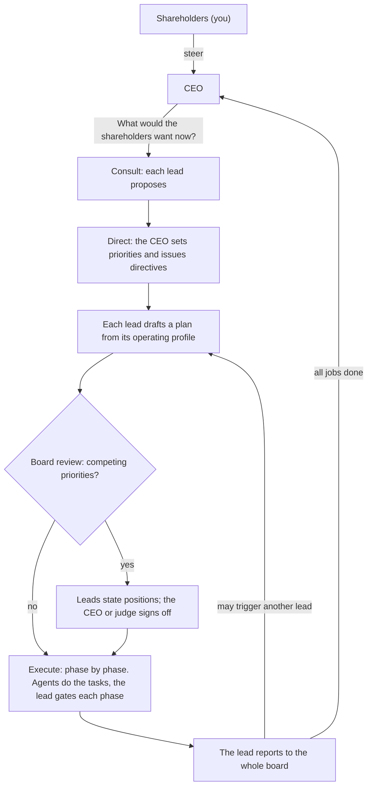

# the_organisation

Describe an idea and get an organisation of AI agents that works on it: a CEO who answers to you, an executive team where every lead follows a standard operating profile, and the agents each lead directs. It runs in a loop. When all the work is done, the CEO asks "What would the shareholders want now?" and the next cycle begins.

You are the shareholders. You give steer; the CEO enforces it.

Built around Claude, with a web interface for establishing organisations and watching them work.


## Quick start

Requires Node 22 or later.

```bash
npm install
npm run dev
```

Open <http://127.0.0.1:4780>.

With no Anthropic credentials the server runs in **simulation**: every seat gives a scripted answer, so you can watch the whole loop work and try every control without spending anything. To run on Claude:

```bash
cp .env.example .env    # then set ANTHROPIC_API_KEY
npm run dev
```

To establish an organisation from a single prompt on the command line (with the server running):

```bash
npm run establish -- "A marketplace where local bakeries sell the day's surplus bread"
npm run establish -- --budget 20 --steer "One city first." "…"
```

For a production-style run, `npm run build && npm start`.

## How an organisation works



**Seats.** Every organisation has a CEO. You seat up to eight executive leads beside it, either from a recommendation (describe the idea and a team is proposed, with reasons) or by hand from the profile library. A seat that is not in the library can be added with its own title, remit and phases.

**Standard operating profiles.** Each profile type always works the same way. Every plan a lead owns runs its phases in order, and a phase must pass the lead's gate review before the next begins.

| Seat | Leads | Operating profile |
| --- | --- | --- |
| CTO | Engineering | Spec → Build → Test → Release |
| CPO | Product | Discover → Define → Prioritise → Validate |
| CMO | Marketing | Research → Position → Create → Launch |
| CFO | Finance | Assess → Model → Budget → Report |
| COO | Operations | Map → Design → Implement → Monitor |
| CRO | Sales | Target → Qualify → Pitch → Close |
| General Counsel | Legal | Identify → Analyse → Advise → Document |
| CHRO | People | Assess → Design → Recruit → Develop |
| CDO | Data | Collect → Analyse → Model → Report |
| Head of Research | Research | Question → Investigate → Synthesise → Recommend |
| CXO | Design | Research → Concept → Design → Handoff |
| CISO | Security | Assess → Harden → Verify → Monitor |
| CCO | Customer | Listen → Diagnose → Resolve → Improve |
| CSO | Strategy | Scan → Frame → Choose → Plan |

The library lives in [`src/shared/profiles.ts`](src/shared/profiles.ts); add or change profile types there.

**Agents.** Each lead is allocated a number of agents (1 to 8, adjustable while the organisation runs). For each phase the lead hands out tasks; its agents work them in parallel, never more at once than the lead has agents, and report back to the lead. Agents put their work products in a shared workspace as files, which every seat and agent can read.

**Reports as triggers.** When a plan has run every phase, the lead reports to the whole board. Each other lead reads the report once their own plan is off their desk and may start follow-up work in their own remit. How many rounds of follow-up one cycle allows is a setting, and no lead starts more than two follow-ups in a cycle; anything further waits for the CEO.

**Decisions.**

- A lead decides anything inside their own remit, and the decision is recorded.
- When leads have competing priorities (another lead objects to a plan, or the plan's owner flags something that cuts across remits), the plan goes to the board. Every lead states a position. If they agree, the arbiter ratifies it; if not, the arbiter rules. The ruling can let the plan proceed, bind it with amendments or cancel it.
- The arbiter is the CEO, who rules by what the shareholders want, or an independent judge seated on the board with no remit of their own. You choose which.

**Steer.** Give steer at any time. Before work has begun, the CEO takes it into the cycle's direction and replies. While work is under way, the CEO reviews the plans in progress against it and amends or cancels them, then replies with what changed.

**The loop.** A cycle is consult, direct, work. When every plan is reported or cancelled and every report has been read, the cycle closes, its outcome is digested for the CEO's memory, and the CEO asks the question again. This continues until you pause it, the budget is reached, or a cycle limit you set is hit.

## The interface

- **Home** lists organisations with their status, cycle and spend.
- **Establish** takes the idea, recommends a team or lets you seat one, and sets governance and limits.
- **The dashboard** shows the hierarchy on the left (you, the CEO, the leads on their operating profiles, and which agents are busy with what) and, on the right:
  - **Board**: the feed of everything said at board level, newest first, with completed cycles below it.
  - **Plans**: every plan with its phases, tasks, agent reports, gate reviews and board report.
  - **Decisions**: what went to the board, each lead's position and the ruling, plus the decisions leads took in their own remit.
  - **Files**: the workspace.
  - **Activity**: each unit of work with its tokens, cost and duration.

Start, pause, stop and settings are at the top of the dashboard. Pause lets calls in flight finish; stop cuts them off and puts the interrupted work back in the queue.

## Spend and limits

An organisation that never stops can spend without limit, so every organisation has a **budget** (default $5). Spend is estimated from token usage at the list prices in [`src/server/providers/pricing.ts`](src/server/providers/pricing.ts). When the estimate reaches the budget the organisation pauses itself and waits for you to raise it. It can overshoot by the calls that were already in flight. The estimate is not a bill: check the Anthropic Console for what was charged. Calls cut off by "Stop now" are not counted.

What drives spend, and where to change it (wizard or settings):

- **The model for the agents.** Agents do most of the work. Executives and agents default to `claude-opus-5-5`; each can be set separately.
- **Effort** for executives and agents (default medium).
- **Agents per lead** and **tasks per phase** (default at most 4 tasks).
- **Follow-up work per cycle** (default one round, and never more than two follow-up plans per lead).
- **Web search** for agents (off by default; billed per search by Anthropic).
- **Model calls in flight at once** (default 4), which also keeps you inside rate limits.

If a call fails in a way that may pass (rate limits, overload), it is retried with backoff. If it fails for good, the organisation pauses and shows the error; nothing is lost, and it resumes from where it stopped. The same is true after a server restart: an organisation that was running comes back paused.

## What agents can and cannot do

Agents have three tools, all confined to their organisation's workspace folder: list files, read a file, write a file. With web search switched on they can also search the web. They **cannot run code** or reach any other system, and their prompts tell them not to claim otherwise. An engineering "Test" phase is therefore a review of the build against the spec, not an execution of it.

## Data

Everything is on disk under `data/` (set `ORG_DATA_DIR` to move it), one folder per organisation:

```
data/orgs/<id>/
  org.json         live state: seats, cycle, plans, decisions, board feed, usage
  activity.jsonl   one line per unit of work
  archive/         cycles that have left live state (the three most recent stay live)
  workspace/       the files the agents produce
```

## Configuration

| Variable | Default | Meaning |
| --- | --- | --- |
| `ANTHROPIC_API_KEY` | none | Run on Claude. Any credential the Anthropic SDK resolves works. |
| `ORG_PROVIDER` | `auto` | `claude`, `mock`, or `auto` (Claude if credentials are found, otherwise simulation). |
| `PORT` | `4780` | Port to listen on. |
| `HOST` | `127.0.0.1` | Address to listen on. |
| `ORG_DATA_DIR` | `./data` | Where organisations are stored. |

The API has no login. It listens on loopback, refuses requests that are not addressed to localhost, and refuses cross-site requests, so a web page you visit cannot drive it. If you set `HOST` to something reachable from other machines, anyone who can reach the port controls your organisations and their spend.

## Development

```bash
npm test            # engine, providers, workspace, HTTP API
npm run typecheck
npm run dev         # server with hot-reloading client on one port
```

The tests run whole organisations through the loop on the simulator, and check the scheduler's rules directly. The Claude provider is tested against a local stand-in for the Messages API that speaks its streaming protocol: that checks what is sent and how replies are handled, not that the live API accepts it.

```
src/shared/      types and the profile library, used by server and client
src/server/
  engine/        the loop: what work is ready (work.ts), doing it (handlers.ts),
                 running it (runner.ts), the prompts and the output schemas
  providers/     Claude, the simulator, and pricing
  workspace.ts   the confined file tools agents use
  app.ts         the HTTP API and live event stream
src/client/      the web interface (React)
scripts/         establish an organisation from one prompt
tests/
```

**How the engine runs.** The runner is a reconciler. It asks what work is ready given the organisation's state, starts as much as capacity allows, and asks again whenever something finishes. Each unit of work is one model call (or one agent run) whose result is written back to the state. Because all state is in `org.json`, pause, stop and restart need no special handling.

**Adding a provider.** A provider implements two methods ([`src/server/providers/types.ts`](src/server/providers/types.ts)): `structured`, one call that returns data matching a schema, and `agent`, a tool-using run that ends with a closing message. The engine knows nothing else about the model behind it.

## Limits of this version

- Agents write files; they do not execute anything.
- One organisation is one process's worth of state: there is no multi-user access and no login.
- A board decision is one round of positions and a ruling; there is no further debate.
- Steer given mid-cycle changes plans, not tasks already running: an agent finishes the task it is on.
- Seats are fixed once an organisation is established. Agent allocation, the arbiter and every limit can be changed afterwards.
