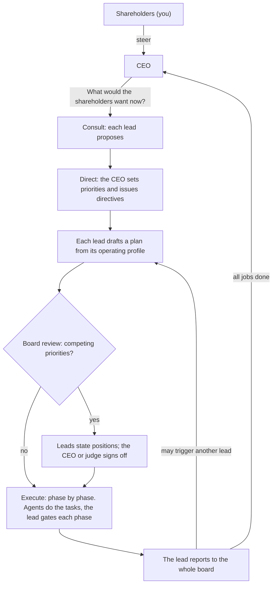

# the_organisation

Describe an idea and get an organisation of AI agents that works on it: a CEO who answers to you, an executive team where every lead follows a standard operating profile, and the agents each lead directs. It runs in a loop. When all the work is done, the CEO asks "What would the shareholders want now?" and the next cycle begins.

You are the shareholders. You give steer; the CEO enforces it.

Built around Claude, with a web interface for establishing organisations and watching them work.


## Quick start

Requires Node 22 or later.

```bash
npm install
npm run dev
```

Open <http://127.0.0.1:4780>.

With no Anthropic credentials the server runs in **simulation**: every seat gives a scripted answer, so you can watch the whole loop work and try every control without spending anything. To run on Claude:

```bash
cp .env.example .env    # then set ANTHROPIC_API_KEY
npm run dev
```

To establish an organisation from a single prompt on the command line (with the server running):

```bash
npm run establish -- "A marketplace where local bakeries sell the day's surplus bread"
npm run establish -- --budget 20 --steer "One city first." "…"
npm run establish -- --hosted --budget 40 "…"    # plans carried out in hosted sessions (see below)
```

For a production-style run, `npm run build && npm start`.

## How an organisation works



**Seats.** Every organisation has a CEO. You seat up to eight executive leads beside it, either from a recommendation (describe the idea and a team is proposed, with reasons) or by hand from the profile library. A seat that is not in the library can be added with its own title, remit and phases.

**Standard operating profiles.** Each profile type always works the same way. Every plan a lead owns runs its phases in order, and a phase must pass the lead's gate review before the next begins.

| Seat | Leads | Operating profile |
| --- | --- | --- |
| CTO | Engineering | Spec → Build → Test → Release |
| CPO | Product | Discover → Define → Prioritise → Validate |
| CMO | Marketing | Research → Position → Create → Launch |
| CFO | Finance | Assess → Model → Budget → Report |
| COO | Operations | Map → Design → Implement → Monitor |
| CRO | Sales | Target → Qualify → Pitch → Close |
| General Counsel | Legal | Identify → Analyse → Advise → Document |
| CHRO | People | Assess → Design → Recruit → Develop |
| CDO | Data | Collect → Analyse → Model → Report |
| Head of Research | Research | Question → Investigate → Synthesise → Recommend |
| CXO | Design | Research → Concept → Design → Handoff |
| CISO | Security | Assess → Harden → Verify → Monitor |
| CCO | Customer | Listen → Diagnose → Resolve → Improve |
| CSO | Strategy | Scan → Frame → Choose → Plan |

The library lives in [`src/shared/profiles.ts`](src/shared/profiles.ts); add or change profile types there.

**Agents.** Each lead is allocated a number of agents (1 to 8, adjustable while the organisation runs). For each phase the lead hands out tasks; its agents work them in parallel, never more at once than the lead has agents, and report back to the lead. Agents put their work products in a shared workspace as files, which every seat and agent can read.

Agents can work in one of two ways, chosen per organisation: **on this machine**, where they read and write files and run nothing, or **in hosted sessions**, where each plan gets a sandbox in which the lead and its agents can run and test what they build. See [Hosted sessions](#hosted-sessions-claude-managed-agents).

**Reports as triggers.** When a plan has run every phase, the lead reports to the whole board. Each other lead reads the report once their own plan is off their desk and may start follow-up work in their own remit. How many rounds of follow-up one cycle allows is a setting, and no lead starts more than two follow-ups in a cycle; anything further waits for the CEO.

**Decisions.**

- A lead decides anything inside their own remit, and the decision is recorded.
- When leads have competing priorities (another lead objects to a plan, or the plan's owner flags something that cuts across remits), the plan goes to the board. Every lead states a position. If they agree, the arbiter ratifies it; if not, the arbiter rules. The ruling can let the plan proceed, bind it with amendments or cancel it.
- The arbiter is the CEO, who rules by what the shareholders want, or an independent judge seated on the board with no remit of their own. You choose which.

**Steer.** Give steer at any time. Before work has begun, the CEO takes it into the cycle's direction and replies. While work is under way, the CEO reviews the plans in progress against it and amends or cancels them, then replies with what changed.

**The loop.** A cycle is consult, direct, work. When every plan is reported or cancelled and every report has been read, the cycle closes, its outcome is digested for the CEO's memory, and the CEO asks the question again. This continues until you pause it, the budget is reached, or a cycle limit you set is hit.

## The interface

- **Home** lists organisations with their status, cycle and spend.
- **Establish** takes the idea, recommends a team or lets you seat one, and sets governance and limits.
- **The dashboard** shows the hierarchy on the left (you, the CEO, the leads on their operating profiles, and which agents are busy with what) and, on the right:
  - **Board**: the feed of everything said at board level, newest first, with completed cycles below it.
  - **Plans**: every plan with its phases, tasks, agent reports, gate reviews and board report.
  - **Decisions**: what went to the board, each lead's position and the ruling, plus the decisions leads took in their own remit.
  - **Files**: the workspace.
  - **Activity**: each unit of work with its tokens, cost and duration.

Start, pause, stop and settings are at the top of the dashboard. Pause lets calls in flight finish; stop cuts them off and puts the interrupted work back in the queue. Either one holds hosted sessions where they are.

## Spend and limits

An organisation that never stops can spend without limit, so every organisation has a **budget** (default $5). Spend is estimated from token usage at the list prices in [`src/server/providers/pricing.ts`](src/server/providers/pricing.ts). When the estimate reaches the budget the organisation pauses itself and waits for you to raise it. Agents that are mid-task at that moment are told to stop and report what they have, so their work is kept rather than paid for again; the spend can therefore pass the budget by about one more model turn for each agent at work. The estimate is not a bill: check the Anthropic Console for what was charged. Calls cut off by "Stop now" are not counted, and neither is a team recommendation in the wizard, which belongs to no organisation (the wizard shows what it cost).

What drives spend, and where to change it (wizard or settings):

- **The model for the agents.** Agents do most of the work. Executives and agents default to `claude-opus-5-5`; each can be set separately.
- **Effort** for executives and agents (default medium).
- **Agents per lead** and **tasks per phase** (default at most 4 tasks).
- **Follow-up work per cycle** (default one round, and never more than two follow-up plans per lead).
- **Web search** for agents (off by default; billed per search by Anthropic; at most 8 searches per task).
- **Model calls in flight at once** (default 4), which also keeps you inside rate limits.

If a call fails in a way that may pass (rate limits, overload, a dropped connection), it is retried with backoff; an agent that is part-way through a task repeats only the turn that failed, not the task. If a call fails for good, the organisation pauses and shows the error; nothing is lost, and it resumes from where it stopped. The same is true after a server restart: an organisation that was running comes back paused.

## What agents can and cannot do

**On this machine** (the default), agents have three tools, all confined to their organisation's workspace folder: list files, read a file, write a file. With web search switched on they can also search the web. They **cannot run code** or reach any other system, and their prompts tell them not to claim otherwise. An engineering "Test" phase is therefore a review of the build against the spec, not an execution of it.

**In hosted sessions**, agents have a shell and file tools in a sandbox on Anthropic's side. They can install packages, build, run and test, and are told to report what actually happened.

## Hosted sessions (Claude Managed Agents)

This way of working is built on [Claude Managed Agents](https://platform.claude.com/docs/en/managed-agents/overview), which is in beta. Choose it when establishing an organisation ("The leads' agents do their work: in hosted sessions"), in an organisation's settings, or with `--hosted` on the command line. The board's own work (consulting, directing, planning, reviewing, deciding) is the same either way; what changes is how a plan is carried out once the board has cleared it.


*A plan in a hosted session, here in simulation.*

> **Not yet run against the live API.** This part was written from the API's documentation and the SDK's types, and is tested against a local stand-in for the API (`tests/fake-managed-api.ts`). No session has been started on a real account. Expect to find things the stand-in did not: start with one lead, a small budget and the Console open.

**One session per plan.** When a plan starts, a session is created for it. The lead is the session's agent, with its seat, the plan and the organisation's files. Its team are copies of one saved agent, the "Team agent", which the lead gives tasks to; each keeps what it learned for the rest of the plan. The lead takes the phases of its operating profile in order, reviews each phase's files itself (running them where they can be run), and records the phase with the organisation before starting the next. A phase is refused if the one before it has not been recorded. When every phase is recorded the lead reports to the board, and from there everything is as before.

**Dynamic workflows are on.** A lead can write a workflow, a small program that puts many agents on the pieces of one phase and combines what they return, and the platform runs it in the background. Leads are told to start a run only when a phase has more separate pieces than their agents could take one each (many files to check, many sources to read), and to hand a handful of tasks out directly. Every agent in a run uses tokens, which is why every session has a spend cap. To turn workflows off for an organisation, untick "Let leads start workflow runs" in the wizard or in its settings: its leads are then started from an agent saved with `workflows: {"type": "disabled"}`, and their instructions say to hand every task out themselves.

**Agents per lead.** The number of agents a lead is allocated is told to the lead, and it is told that a run must not have more working at once. On this machine that number is enforced; in a session it is an instruction. The spend cap is the hard limit, and the dashboard says so if a lead goes over its allocation. The platform itself allows a session 25 agents at most, outside workflow runs; leads are told to keep to their own and reuse them.

**Spend.** Each session is created with a spend cap that the platform enforces: at the cap it starts no new model request, in the lead, its agents or a run. What is left of the organisation's budget is shared equally between the plans that want a session, so the caps never add up to more than the budget. A session that reaches its cap waits there, intact, and is given more when another plan finishes under its share or you raise the budget. Spend is what the platform reports for the session at list prices, which includes the sandbox's running time and web searches as well as tokens; the request that reaches a cap completes, so a session can end a little past it. Sessions cost more per plan than work on this machine, because agents work for longer on each task: allow several times the budget, and raise it once you have seen a cycle.

**Pause, stop and restart.** A session is held by bringing its cap down to what it has spent, so nothing in it can run until the organisation is resumed, when the cap is raised again and the work carries on in the same session. The same is done before the organisation gives up on a session after a failure, so a session nobody is following cannot go on spending. If the server stops without warning, a session carries on by itself as far as its next phase record (which waits for the organisation's answer) or its cap, whichever comes first, and is picked up from there on resume. A workflow run's time limit keeps running while its session is held: after a long pause the run may have timed out, and the lead is told to start it again for what is left.

**What a session may do.** Tool calls in the sandbox are judged by the platform one at a time (the `auto` permission policy): calls it judges safe run, calls it judges high-risk are refused, and calls it cannot judge wait for approval. Nobody is watching these sessions, so those are declined, and the agent is told to find another way. Each plan shows how many calls were declined and the most recent one.

**Network.** With web search off, the sandbox can reach package registries and nothing else. With web search on, agents get web search and fetch, and the sandbox's network is open: code the agents run there can reach any site. That is the only way to give hosted agents general web access, so it is tied to the same switch, and the wizard and settings say so when you turn it on.

**Files.** The most recent files in the workspace (up to 200, none over 5 MB) are mounted read-only in the sandbox under `/mnt/session/uploads/workspace/`. Whatever a session writes under `/mnt/session/outputs/` is brought back to the workspace when each phase is recorded and at the end, always inside the owning team's directory. Files over 25 MB stay in the session.

**What it leaves on your Anthropic account.** Nothing here ever archives or deletes anything there.

- Two saved agents (the lead and the team agent) for each combination of agent model, agent effort, web setting and workflow switch in use, and one environment for each network setting. They are created the first time they are needed, or by `npm run managed:setup`, and their ids are kept in `data/managed.json`. If their definition in this repository changes, they are saved as a new version, not a new agent.
- One session per plan, which stays as the plan's record. Each plan links to its session in the Anthropic Console. Deleting an organisation here does not delete its sessions.
- Uploaded copies of workspace files, which expire after thirty days.

The Console link needs the workspace your API key belongs to. For the Default workspace nothing is needed; otherwise set `ANTHROPIC_WORKSPACE_ID`.

## Data

Everything is on disk under `data/` (set `ORG_DATA_DIR` to move it), one folder per organisation:

```
data/orgs/<id>/
  org.json         live state: seats, cycle, plans, decisions, board feed, usage
  activity.jsonl   one line per unit of work
  archive/         cycles that have left live state (the three most recent stay live)
  workspace/       the files the agents produce
  managed/         which workspace files have been uploaded for hosted sessions
data/managed.json  ids of the agents and environments hosted sessions start from
```

A folder is loaded only if its name is the organisation's id, so a copy kept beside it as a backup is ignored rather than mistaken for the original.

## Configuration

| Variable | Default | Meaning |
| --- | --- | --- |
| `ANTHROPIC_API_KEY` | none | Run on Claude. Any credential the Anthropic SDK resolves works. |
| `ORG_PROVIDER` | `auto` | `claude`, `mock`, or `auto` (Claude if credentials are found, otherwise simulation). |
| `PORT` | `4780` | Port to listen on. |
| `HOST` | `127.0.0.1` | Address to listen on. |
| `ORG_DATA_DIR` | `./data` | Where organisations are stored. |
| `ANTHROPIC_WORKSPACE_ID` | Default workspace | The workspace your API key belongs to, for links from a plan to its hosted session in the Console. |

The API has no login. It listens on loopback, refuses requests that are not addressed to localhost, and refuses cross-site requests, so a web page you visit cannot drive it. If you set `HOST` to something reachable from other machines, anyone who can reach the port controls your organisations and their spend.

## Development

```bash
npm test            # engine, providers, workspace, HTTP API
npm run typecheck
npm run dev         # server with hot-reloading client on one port
```

The tests run whole organisations through the loop on the simulator, and check the scheduler's rules directly. The Claude provider is tested against local stand-ins for the Messages API and the Managed Agents API that speak their protocols: that checks what is sent and how replies are handled, not that the live APIs accept it or behave as the stand-ins do.

```
src/shared/      types and the profile library, used by server and client
src/server/
  engine/        the loop: what work is ready (work.ts), doing it (handlers.ts,
                 and hosted.ts for a plan in a hosted session), running it
                 (runner.ts), the prompts and the output schemas
  providers/     Claude, the simulator, and pricing
    managed/     hosted sessions: the saved agents (resources.ts), files in
                 and out (files.ts), and following a session (session.ts)
  workspace.ts   the confined file tools agents use
  app.ts         the HTTP API and live event stream
src/client/      the web interface (React)
scripts/         establish an organisation from one prompt; set up hosted sessions
tests/
```

**How the engine runs.** The runner is a reconciler. It asks what work is ready given the organisation's state, starts as much as capacity allows, and asks again whenever something finishes. Each unit of work is one model call (or one agent run) whose result is written back to the state. Because all state is in `org.json`, pause, stop and restart need no special handling. A plan in a hosted session is one long unit of work: the session tells the engine what happens as it happens (phases recorded, agents given work, files, spend), and the plan's state is updated then, not at the end.

**Adding a provider.** A provider implements two methods ([`src/server/providers/types.ts`](src/server/providers/types.ts)): `structured`, one call that returns data matching a schema, and `agent`, a tool-using run that ends with a closing message. The engine knows nothing else about the model behind it. A provider that can carry a whole plan through somewhere else also implements `executePlan`; with one that cannot, plans set for hosted sessions are carried out on this machine.

## Limits of this version

- On this machine, agents write files and execute nothing. Running and testing needs hosted sessions.
- Hosted sessions have not been run against the live API (see above), and hold a lead to its allocation of agents by instruction only.
- One organisation is one process's worth of state: there is no multi-user access and no login.
- A board decision is one round of positions and a ruling; there is no further debate.
- Steer given mid-cycle changes plans, not tasks already running: an agent finishes the task it is on.
- Seats are fixed once an organisation is established. Agent allocation, the arbiter and every limit can be changed afterwards.
