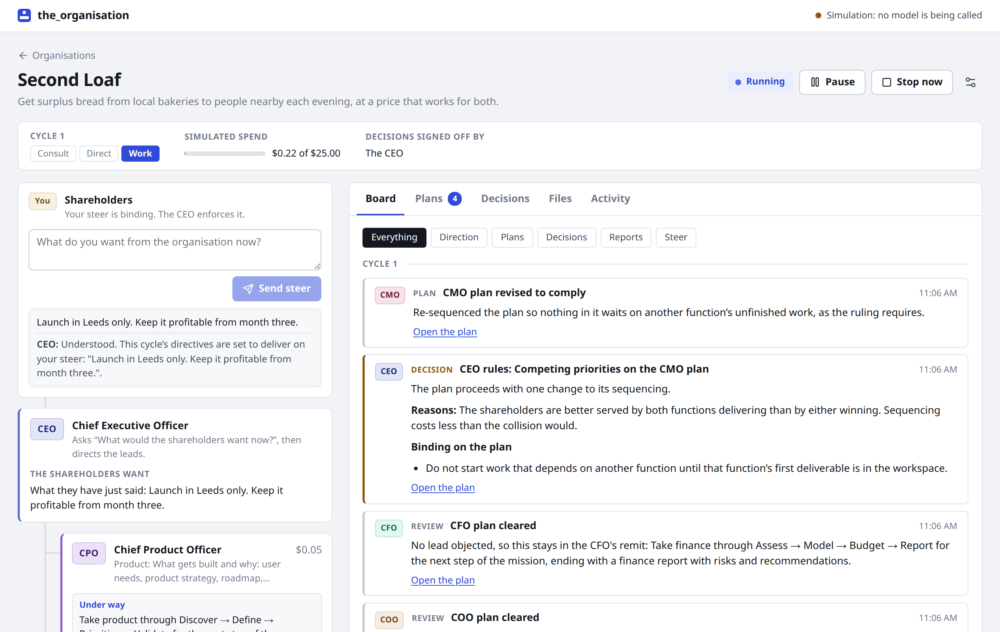
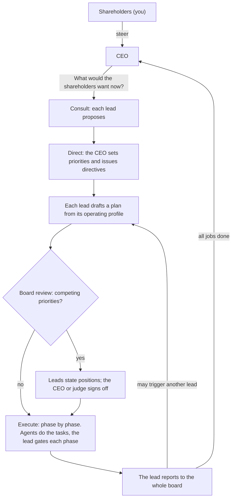

# the_organisation

Describe an idea and get an organisation of AI agents that works on it: a CEO who answers to you, an executive team where every lead follows a standard operating profile, and the agents each lead directs. It runs in a loop. When all the work is done, the CEO asks "What would the shareholders want now?" and the next cycle begins.

You are the shareholders. You give steer; the CEO enforces it. The organisation cannot pay for anything or sign anything: for that it asks its [Authorised Signatory](#signing-and-paying), which is you unless you seat an AI there, and you do the paying and signing yourself, outside this program.

Built around Claude, and able to run on other makers' models as well (OpenAI, Google, Meta and the main Chinese labs), with a web interface for establishing organisations and watching them work.



## Quick start

Requires Node 22 or later.

```bash
npm install
npm run dev
```

Open <http://127.0.0.1:4780>.

Until it is given an API key the server runs in **simulation**: every seat gives a scripted answer, so you can watch the whole loop work and try every control without spending anything. To call real models, open **Models and keys** in the interface and add a key for any of the providers listed [below](#models-and-keys), or give keys in a file:

```bash
cp .env.example .env    # then set ANTHROPIC_API_KEY, OPENAI_API_KEY, or any of the others in that file
npm run dev
```

To establish an organisation from a single prompt on the command line (with the server running):

```bash
npm run establish -- "A marketplace where local bakeries sell the day's surplus bread"
npm run establish -- --budget 20 --steer "One city first." "…"
npm run establish -- --hosted --budget 40 "…"    # plans carried out in hosted sessions (see below)
npm run establish -- --model openai:gpt-6.1-sol --agent-model deepseek:deepseek-flash "…"
```

For a production-style run, `npm run build && npm start`.

## How an organisation works



**Seats.** Every organisation has a CEO and an [Authorised Signatory](#signing-and-paying). You seat up to eight executive leads beside them, either from a recommendation (describe the idea and a team is proposed, with reasons) or by hand from the profile library. A seat that is not in the library can be added with its own title, remit and phases.

**Standard operating profiles.** Each profile type always works the same way. Every plan a lead owns runs its phases in order, and a phase must pass the lead's gate review before the next begins.

| Seat | Leads | Operating profile |
| --- | --- | --- |
| CTO | Engineering | Spec → Build → Test → Release |
| CPO | Product | Discover → Define → Prioritise → Validate |
| CMO | Marketing | Research → Position → Create → Launch |
| CFO | Finance | Assess → Model → Budget → Report |
| COO | Operations | Map → Design → Implement → Monitor |
| CRO | Sales | Target → Qualify → Pitch → Close |
| General Counsel | Legal | Identify → Analyse → Advise → Document |
| CHRO | People | Assess → Design → Recruit → Develop |
| CDO | Data | Collect → Analyse → Model → Report |
| Head of Research | Research | Question → Investigate → Synthesise → Recommend |
| CXO | Design | Research → Concept → Design → Handoff |
| CISO | Security | Assess → Harden → Verify → Monitor |
| CCO | Customer | Listen → Diagnose → Resolve → Improve |
| CSO | Strategy | Scan → Frame → Choose → Plan |

The library lives in [`src/shared/profiles.ts`](src/shared/profiles.ts); add or change profile types there.

**Agents.** Each lead is allocated a number of agents (1 to 8, adjustable while the organisation runs). For each phase the lead hands out tasks; its agents work them in parallel, never more at once than the lead has agents, and report back to the lead. Agents put their work products in a shared workspace as files, which every seat and agent can read.

Agents can work in one of two ways, chosen per organisation: **on this machine**, where they read and write files and run nothing, or **in hosted sessions**, where each plan gets a sandbox in which the lead and its agents can run and test what they build. See [Hosted sessions](#hosted-sessions-claude-managed-agents).

**Reports as triggers.** When a plan has run every phase, the lead reports to the whole board. Each other lead reads the report once their own plan is off their desk and may start follow-up work in their own remit. How many rounds of follow-up one cycle allows is a setting, and no lead starts more than two follow-ups in a cycle; anything further waits for the CEO.

**Decisions.**

- A lead decides anything inside their own remit, and the decision is recorded.
- When leads have competing priorities (another lead objects to a plan, or the plan's owner flags something that cuts across remits), the plan goes to the board. Every lead states a position. If they agree, the arbiter ratifies it; if not, the arbiter rules. The ruling can let the plan proceed, bind it with amendments or cancel it.
- The arbiter is the CEO, who rules by what the shareholders want, or an independent judge seated on the board with no remit of their own. You choose which.

**Steer.** Give steer at any time. Before work has begun, the CEO takes it into the cycle's direction and replies. While work is under way, the CEO reviews the plans in progress against it and amends or cancels them, then replies with what changed.

**The loop.** A cycle is consult, direct, work. When every plan is reported or cancelled and every report has been read, the cycle closes, its outcome is digested for the CEO's memory, and the CEO asks the question again. This continues until you pause it, the budget is reached, or a cycle limit you set is hit.

## The interface

- **Home** lists organisations with their status, cycle and spend.
- **Establish** takes the idea, recommends a team or lets you seat one, and sets governance and limits.
- **The dashboard** shows the hierarchy on the left (you, the CEO, the leads on their operating profiles, and which agents are busy with what) and, on the right:
  - **Board**: the feed of everything said at board level, newest first, with completed cycles below it.
  - **Plans**: every plan with its phases, tasks, agent reports, gate reviews and board report.
  - **Decisions**: what went to the board, each lead's position and the ruling, plus the decisions leads took in their own remit.
  - **Signatory**: what the organisation has asked to have paid for or signed, and where you tell it what you did. The tab, the dashboard and the home page show how many requests are waiting for you.
  - **Files**: the workspace.
  - **Activity**: each unit of work with its tokens, cost and duration.

Start, pause, stop and settings are at the top of the dashboard. Pause lets calls in flight finish; stop cuts them off and puts the interrupted work back in the queue. Either one holds hosted sessions where they are.

## Signing and paying

An organisation of agents can draft a contract and choose a supplier, but it cannot sign the one or pay the other, and nothing in this program can move money or bind you to anything. What every organisation has instead is one more seat on its board, the **Authorised Signatory**, and a rule that every seat works under: until the signatory says a thing is done, it has not happened, and nothing may be planned, written or reported as though it had.


*The Signatory tab, here in simulation.*

**Who holds the seat.** You do, unless you choose otherwise when establishing the organisation or afterwards in its settings.

- **You** (the default). A request waits until you have paid or signed, outside this program, and said so here, or have refused it.
- **An AI seat.** The AI reads each request with the files the lead named, the plan it is for and your steer, and authorises or declines it, with a reason. To authorise is not to do: what it authorises then waits for you to carry out and confirm, and you can still refuse it. What it declines you can take back and decide yourself, and the AI is not asked a second time. The AI rules only while the organisation is running, and you never have to wait for it: a request that is still with the AI can be answered by you in the same way. What you write in the message box is shown to the AI as well, so a limit you set there ("authorise nothing over 20 a month") is one it is told to hold to. Changing who holds the seat takes effect at once, for requests already waiting as well.

**How a request is raised.** At each phase gate a lead is asked whether its plan now needs something paid for or signed for the work to take effect. If it does, the lead puts a request to the signatory: a payment (what for, how much, to whom) or a signature (what, and with whom), why it is needed now, and the files to read first. In a hosted session the lead asks when it records the phase. A lead can raise three requests at one gate, however often the gate is reviewed, and have ten open at a time, and asking again for something that is still open is the same request, not a second one.

**The work does not wait.** A request that is waiting for you holds up neither the plan that raised it nor the cycle. The organisation carries on, and each lead and the CEO are shown what is still waiting whenever they propose, plan, hand out work, gate a phase or report, so they work round it.

**Answering.** The **Signatory** tab is your conversation with the organisation. Each request that is waiting for you has two buttons: **I have paid this** (or **I have signed this**) and **Reject it**. Saying it is done takes an optional note ("Paid by card today, reference 12345"). Rejecting needs a reason, because the reason is what the organisation acts on. Either answer can be taken back if it was given to the wrong request; if the cycle has closed in the meantime, its record is corrected to say so. You can also send a message that is not about any one request ("Nothing can be paid before Monday").

Answers are given with buttons on purpose. What you type in the message box is passed on as you wrote it; it is never read as "that one is paid".

**How the organisation hears.** Your answer goes on the board, into what the leads and the CEO are shown the next time they act, and into the cycle's record; a plan in a hosted session is told in the reply to its next phase record. An answer or a message is repeated for the cycle it was given in and the one after. For a rule that should always hold ("no payment over 50 a month without asking first"), give it as shareholder steer instead.

**When a plan is cancelled**, what it asked for is withdrawn, so nobody pays for work that has been stopped.

**Check before you pay.** A request is written by a model. Its amount, its payee and its reason are what the model wrote, not facts this program has checked, and a model can be wrong about any of them. Read the files it points to and confirm the details yourself, as you would with anything a new member of staff asked you to pay. A request is shown as plain words wherever it appears, and a link in one is written out as its label and its address when the request is filed, so that you are never one click from an address a model chose.

## Models and keys

An organisation's executives and its agents each run on a model you choose, and the two can be from different makers. Which models are on offer depends on which API keys the server has.

**Adding a key.** The **Models and keys** page (linked from the top bar) lists the providers below. Choose one, paste a key, and the provider is asked what the key can call; a key it refuses is not kept. From then on that key's models can be chosen when establishing an organisation and in any organisation's settings: the handful picked out for the provider first, with their prices, then everything else the key can call. A key can also be given in the environment or in `.env`, under the variable in the table; it is then used as it is and never written to disk by this program.


Keys added in the interface are kept in `data/connections.json`, which only your user can read. The interface is shown the last four characters of a key and nothing more, and a key that a provider quotes back in an error message is taken out before the message is shown or stored. A key is only ever sent to the address it was added for: that address cannot be changed afterwards, so to use a key somewhere else, add it again there.

Simulation is for a server that has never had a key. Once it has had one, removing every key does not bring the simulator back: organisations pause at their next call and say which key they need, because scripted answers passed off as the work of the models an organisation was set to would be worse than a pause. To simulate on purpose, start the server with `ORG_PROVIDER=mock`.

| Provider | Models | Key variable | Picked out (list price in and out, US dollars per million tokens) |
| --- | --- | --- | --- |
| Anthropic | Claude | `ANTHROPIC_API_KEY` | Opus 5.5 ($4, $20), Fable 5.1 ($10, $50), Sonnet 5.5 ($2, $10), Haiku 5.5 ($0.10, $0.50) |
| OpenAI | GPT | `OPENAI_API_KEY` | GPT-6 Astra ($10, $50), GPT-6.1 Sol ($2, $10), GPT-6.1 Terra ($1, $5), GPT-6 Luna ($0.10, $0.50) |
| Google | Gemini | `GEMINI_API_KEY` | Gemini 4 Argon ($2, $10 until 30 November 2026, then $4, $20), Gemini 3.8 Flash ($0.75, $3.75 until the end of 2026, then $1.50, $7.50), Gemini 3.5 Flash-Lite ($0.30, $2.50) |
| Meta | Muse | `META_API_KEY` | Muse Wonder, a preview ($4, $20), Muse Spark 1.3 ($1.25, $4.25) |
| Moonshot AI | Kimi | `MOONSHOT_API_KEY` | Kimi K3.1 Pro ($2, $10), Kimi K3.1 Pro Highspeed ($4, $20) |
| DeepSeek | DeepSeek | `DEEPSEEK_API_KEY` | V4.1 Flash ($0.30, $1.20 at peak hours), V4 Pro ($1.32, $3.96) |
| Alibaba Cloud Model Studio | Qwen | `DASHSCOPE_API_KEY` | Qwen3.8 Max ($2, $6), Qwen3.7 Plus ($0.40, $1.60), Qwen3.8 Flash ($0.15, $0.47) |
| Z.ai (Zhipu AI) | GLM | `ZAI_API_KEY` | GLM-5.3 ($1.40, $4.40), GLM-5.3 Flash ($0.15, $0.50) |
| Tencent Cloud TokenHub | Hunyuan | `TOKENHUB_API_KEY` | Hy4 ($0.834, $2.501), Hy3 ($0.132, $0.528) |
| MiniMax | MiniMax | `MINIMAX_API_KEY` | M3.1 Flash ($0.15, $0.60), M3 ($0.30, $1.20) |
| ByteDance | Doubao, Seed | `ARK_API_KEY` | International: Seed 2.1 Turbo ($0.50, $2.50). Mainland: Doubao Seed 2.1 Pro (¥6, ¥30) |
| OpenRouter | several hundred, from every maker | `OPENROUTER_API_KEY` | whatever its listing offers, at the prices it lists |
| Another OpenAI-compatible endpoint | whatever it serves | none | none: its models are listed, and you set their prices |

The last row is for anything else that speaks OpenAI's Chat Completions: a server on this machine (llama.cpp's `llama-server`, LM Studio, Ollama, vLLM, none of which needs a key), or a provider with no row of its own. Mistral, Xiaomi and Baidu, for example, can be reached through OpenRouter or as an endpoint of your own. Grok is left out on purpose.

Providers with separate international and mainland-China platforms (Moonshot, Alibaba, Z.ai, Tencent, MiniMax, ByteDance) issue different keys for each, so the form asks which platform a key is for. For a key given in the environment, the international platform is assumed unless `<PROVIDER>_BASE_URL` gives another address, for example `MOONSHOT_BASE_URL=https://api.moonshot.cn/v1`.

**Where these models stand.** The picks follow the two public leaderboards most people go by, as they stood on 5 November 2026. On the [Artificial Analysis Intelligence Index](https://artificialanalysis.ai/leaderboards/models) (version 5.0.1, each model at its best setting, Grok left out):

| Model | Maker | Index | Chosen here as |
| --- | --- | --- | --- |
| Gemini 4 Carbon | Google | 60.0 | not on the public API |
| Claude Opus 5.5 | Anthropic | 59.1 | `claude-opus-5-5` |
| GPT-6 Astra | OpenAI | 56.9 | `openai:gpt-6-astra` |
| GPT-6.1 Sol | OpenAI | 54.6 | `openai:gpt-6.1-sol` |
| Claude Sonnet 5.5 | Anthropic | 54.5 | `claude-sonnet-5-5` |
| GPT-6.1 Terra | OpenAI | 51.3 | `openai:gpt-6.1-terra` |
| Gemini 4 Argon | Google | 50.4 | `google:gemini-4-argon` |
| Muse Wonder Full | Meta | 50.1 | no API |
| Claude Fable 5.1 | Anthropic | 50.0 | `claude-fable-5-1` |
| Kimi K3.1 Pro | Moonshot AI | 46.5 | `moonshot:kimi-k3.1-pro` |
| Muse Wonder | Meta | 43.6 | `meta:muse-wonder-1.0` |
| Claude Haiku 5.5 | Anthropic | 36.5 | `claude-haiku-5-5` |
| Hy4 | Tencent | 34.6 | `tencent:hy4` |
| Qwen3.8 Max | Alibaba | 33.7 | `alibaba:qwen3.8-max` |
| DeepSeek V4.1 Flash | DeepSeek | 32.6 | `deepseek:deepseek-flash` |
| GLM-5.3 | Z.ai | 31.7 | `zhipu:glm-5.3` |
| MiniMax M3.1 Flash | MiniMax | 29.1 | `minimax:MiniMax-M3.1-Flash` |

Two models with no entry here sit between the last two rows, Xiaomi's MiMo-V2.6-Pro (29.9) and Ant's Ling 3.1 Flash (29.6); both are on OpenRouter.

The [Arena text leaderboard](https://arena.ai/leaderboard/text) of 27 October 2026 orders the top differently (Gemini 4 Carbon, Gemini 4 Argon, Claude Opus 5.5, Muse Wonder, Claude Fable 5.1) and puts the Chinese models much closer to the rest. Neither board has scored ByteDance's newest models. These lists go out of date in weeks: the models a key can call are always read from the provider, so a newer model shows up without any change here, under "everything else", until someone adds it to the picks in [`src/server/providers/catalogue.ts`](src/server/providers/catalogue.ts).

**How a model is named.** An organisation's settings hold a model as `<key>:<model id>`, such as `openai:gpt-6.1-sol` or `openrouter:anthropic/claude-opus-5.5`. A second key for the same provider is `openai-2`, and so on. A bare id such as `claude-opus-5-5` is a Claude model on the Anthropic key called `anthropic` (the first one added, or the one from `ANTHROPIC_API_KEY`), which is how organisations were set up before there was a choice. With more than one Anthropic key, each is an account of its own: a hosted session belongs to the key that started it, and the saved agents it starts from are recorded per key. The command line takes the same names: `--model` for the executives (and the agents, unless `--agent-model` names another).

**Prices.** Spend is estimated from the tokens each call reports and the model's list price, so a budget is only as good as the price behind it.

- The picks carry list prices read from each provider's own pricing page on 5 November 2026. Price changes that providers had already announced (Google's, above) take effect on their date. Where a provider charges more for a long prompt, or less for input read from its cache, that is counted.
- A model that is not one of the picks has no known price unless its listing carries one (OpenRouter's does). It is counted at $5 in and $25 out per million tokens, enough that an unknown model is never the cheap choice by accident, and the interface says so wherever the model is chosen. Set its real price on the Models and keys page.
- Any price can be corrected there, and a price set by hand stands over everything else.
- DeepSeek charges half outside its peak hours; spend is counted at the peak price. On the mainland platforms prices are in yuan and mostly lower than the dollar prices used here. In both cases the estimate errs high, which pauses an organisation early instead of letting it overspend.
- OpenRouter reports what each call cost, and that figure is used as it is.

**What only Claude does here.** Hosted sessions need Claude models from one Anthropic key for both executives and agents, since they run on Anthropic's platform. Web search for agents is Anthropic's too. With any other model, plans are carried out on this machine and agents work without search; the interface says so where you choose.

**How the other providers are called.** OpenAI is called through its Responses API, because its current models will not call tools through Chat Completions; nothing is stored on OpenAI's side, and each request carries the whole exchange. Everyone else is called through Chat Completions, with the differences between them written down per provider in the catalogue: what the output cap is called, whether a JSON schema is accepted or only a request for JSON, which effort levels a model takes (an organisation's effort setting is sent as the nearest one), and whether a model's reasoning has to be handed back with its tool calls. When an endpoint refuses something about the form of a request, the request is reshaped and sent again; once a reshaped request has gone through, that way of asking is kept until the server restarts. A refusal that does not say what it objects to is first repeated as it was, in case it was a passing fault, and then tried without each optional setting in turn.

> **Not yet run against any live provider.** No key for any of these providers was available when this was written. Addresses, model names, prices and each API's particulars were read from the providers' documentation, and the code is tested against a local stand-in (`tests/fake-openai-api.ts`) that speaks Chat Completions and the Responses API, including whole organisations run end to end on it. That shows the pieces fit together; it does not show that a real provider accepts what is sent. Try a new provider with a small budget first, and expect the occasional rough edge that only a live run finds.

## Spend and limits

An organisation that never stops can spend without limit, so every organisation has a **budget** (default $5). Spend is estimated from token usage at list prices: Claude's are in [`src/server/providers/pricing.ts`](src/server/providers/pricing.ts) and the other providers' in [`src/server/providers/catalogue.ts`](src/server/providers/catalogue.ts) (see [Prices](#models-and-keys) above). When the estimate reaches the budget the organisation pauses itself and waits for you to raise it. Agents that are mid-task at that moment are told to stop and report what they have, so their work is kept rather than paid for again; the spend can therefore pass the budget by about one more model turn for each agent at work. The estimate is not a bill: check the provider's own console for what was charged. Calls cut off by "Stop now" are not counted, and neither is a team recommendation in the wizard, which belongs to no organisation (the wizard shows what it cost).

What drives spend, and where to change it (wizard or settings):

- **The model for the agents.** Agents do most of the work. Executives and agents start on the same model: Claude Opus 5.5 where there is an Anthropic key, and otherwise a mid-priced model of the first key connected (`gpt-6.1-sol` for OpenAI, for example). Each can be set separately.
- **Effort** for executives and agents (default medium).
- **Agents per lead** and **tasks per phase** (default at most 4 tasks).
- **Follow-up work per cycle** (default one round, and never more than two follow-up plans per lead).
- **Web search** for agents (off by default; Claude models only; billed per search by Anthropic; at most 8 searches per task).
- **Model calls in flight at once** (default 4), which also keeps you inside rate limits.

If a call fails in a way that may pass (rate limits, overload, a dropped connection), it is retried with backoff; an agent that is part-way through a task repeats only the turn that failed, not the task. If a call fails for good, the organisation pauses and shows the error; nothing is lost, and it resumes from where it stopped. The same is true after a server restart: an organisation that was running comes back paused.

## What agents can and cannot do

**On this machine** (the default), agents have three tools, all confined to their organisation's workspace folder: list files, read a file, write a file. With web search switched on, agents on Claude models can also search the web. They **cannot run code** or reach any other system, and their prompts tell them not to claim otherwise. An engineering "Test" phase is therefore a review of the build against the spec, not an execution of it.

**In hosted sessions** (Claude models only), agents have a shell and file tools in a sandbox on Anthropic's side. They can install packages, build, run and test, and are told to report what actually happened.

## Hosted sessions (Claude Managed Agents)

This way of working is built on [Claude Managed Agents](https://platform.claude.com/docs/en/managed-agents/overview), which is in beta. Choose it when establishing an organisation ("The leads' agents do their work: in hosted sessions"), in an organisation's settings, or with `--hosted` on the command line. The board's own work (consulting, directing, planning, reviewing, deciding) is the same either way; what changes is how a plan is carried out once the board has cleared it.


*A plan in a hosted session, here in simulation.*

> **Not yet run against the live API.** This part was written from the API's documentation and the SDK's types, and is tested against a local stand-in for the API (`tests/fake-managed-api.ts`). No session has been started on a real account. Expect to find things the stand-in did not: start with one lead, a small budget and the Console open.

**One session per plan.** When a plan starts, a session is created for it. The lead is the session's agent, with its seat, the plan and the organisation's files. Its team are copies of one saved agent, the "Team agent", which the lead gives tasks to; each keeps what it learned for the rest of the plan. The lead takes the phases of its operating profile in order, reviews each phase's files itself (running them where they can be run), and records the phase with the organisation before starting the next. A phase is refused if the one before it has not been recorded. When every phase is recorded the lead reports to the board, and from there everything is as before.

**Dynamic workflows are on.** A lead can write a workflow, a small program that puts many agents on the pieces of one phase and combines what they return, and the platform runs it in the background. Leads are told to start a run only when a phase has more separate pieces than their agents could take one each (many files to check, many sources to read), and to hand a handful of tasks out directly. Every agent in a run uses tokens, which is why every session has a spend cap. To turn workflows off for an organisation, untick "Let leads start workflow runs" in the wizard or in its settings: its leads are then started from an agent saved with `workflows: {"type": "disabled"}`, and their instructions say to hand every task out themselves.

**Agents per lead.** The number of agents a lead is allocated is told to the lead, and it is told that a run must not have more working at once. On this machine that number is enforced; in a session it is an instruction. The spend cap is the hard limit, and the dashboard says so if a lead goes over its allocation. The platform itself allows a session 25 agents at most, outside workflow runs; leads are told to keep to their own and reuse them.

**Spend.** Each session is created with a spend cap that the platform enforces: at the cap it starts no new model request, in the lead, its agents or a run. What is left of the organisation's budget is shared equally between the plans that want a session, so the caps never add up to more than the budget. A session that reaches its cap waits there, intact, and is given more when another plan finishes under its share or you raise the budget. Spend is what the platform reports for the session at list prices, which includes the sandbox's running time and web searches as well as tokens; the request that reaches a cap completes, so a session can end a little past it. Sessions cost more per plan than work on this machine, because agents work for longer on each task: allow several times the budget, and raise it once you have seen a cycle.

**Pause, stop and restart.** A session is held by bringing its cap down to what it has spent, so nothing in it can run until the organisation is resumed, when the cap is raised again and the work carries on in the same session. The same is done before the organisation gives up on a session after a failure, so a session nobody is following cannot go on spending. If the server stops without warning, a session carries on by itself as far as its next phase record (which waits for the organisation's answer) or its cap, whichever comes first, and is picked up from there on resume. A workflow run's time limit keeps running while its session is held: after a long pause the run may have timed out, and the lead is told to start it again for what is left.

**What a session may do.** Tool calls in the sandbox are judged by the platform one at a time (the `auto` permission policy): calls it judges safe run, calls it judges high-risk are refused, and calls it cannot judge wait for approval. Nobody is watching these sessions, so those are declined, and the agent is told to find another way. Each plan shows how many calls were declined and the most recent one.

**Network.** With web search off, the sandbox can reach package registries and nothing else. With web search on, agents get web search and fetch, and the sandbox's network is open: code the agents run there can reach any site. That is the only way to give hosted agents general web access, so it is tied to the same switch, and the wizard and settings say so when you turn it on.

**Files.** The most recent files in the workspace (up to 200, none over 5 MB) are mounted read-only in the sandbox under `/mnt/session/uploads/workspace/`. Whatever a session writes under `/mnt/session/outputs/` is brought back to the workspace when each phase is recorded and at the end, always inside the owning team's directory. Files over 25 MB stay in the session.

**What it leaves on your Anthropic account.** Nothing here ever deletes anything there, and nothing is archived unless you ask.

- Two saved agents (the lead and the team agent) for each combination of agent model, agent effort, web setting and workflow switch in use, and one environment for each network setting. They are created the first time they are needed, or by `npm run managed:setup`, and their ids are kept in `data/managed.json`. If their definition in this repository changes, they are saved as a new version, not a new agent.
- One session per plan, which stays as the plan's record. Each plan links to its session in the Anthropic Console. Deleting an organisation here does not delete its sessions.
- Sessions can be **archived**, which keeps them readable in the Console but closed to change, and cannot be undone. Either switch on "Archive each plan's session once the plan is over" for an organisation (off by default), or archive by hand: a button on a finished plan's session, and one in settings for every plan that is over. A session that is still working is left alone. Deleting an organisation that is set to archive archives its sessions first.
- Uploaded copies of workspace files, which expire after thirty days.

The Console link needs the workspace your API key belongs to. For the Default workspace nothing is needed; otherwise set `ANTHROPIC_WORKSPACE_ID`.

## Data

Everything is on disk under `data/` (set `ORG_DATA_DIR` to move it), one folder per organisation:

```
data/orgs/<id>/
  org.json         live state: seats, cycle, plans, decisions, board feed, the signatory's
                   requests and conversation, usage
  activity.jsonl   one line per unit of work
  archive/         cycles that have left live state (the three most recent stay live)
  workspace/       the files the agents produce
  managed/         which workspace files have been uploaded for hosted sessions
data/managed.json      ids of the agents and environments hosted sessions start from
data/connections.json  the API keys added in the interface, and what each was last seen to offer
```

`connections.json` holds keys in the clear, readable only by your user. Leave it out of anything you share or back up to somewhere others can read; the whole `data/` folder is already ignored by git.

A request to the signatory is archived with the cycle in which it was settled, along with everything said about it. One that is still waiting stays in live state however old it is.

A folder is loaded only if its name is the organisation's id, so a copy kept beside it as a backup is ignored rather than mistaken for the original.

## Configuration

| Variable | Default | Meaning |
| --- | --- | --- |
| `ANTHROPIC_API_KEY` | none | A key for Claude. Any other credential the Anthropic SDK resolves by itself (a login profile, say) works too. |
| `OPENAI_API_KEY`, `GEMINI_API_KEY`, and the rest | none | A key for another provider: the variable for each is in the table under [Models and keys](#models-and-keys). Keys can also be added in the interface. |
| `<PROVIDER>_BASE_URL` | the provider's international address | Where a provider's key from the environment is used, for a provider with more than one platform: `MOONSHOT_BASE_URL`, `ALIBABA_BASE_URL`, `ZHIPU_BASE_URL`, `TENCENT_BASE_URL`, `MINIMAX_BASE_URL`, `BYTEDANCE_BASE_URL` (the name before the colon in a model's name, in capitals). |
| `ORG_PROVIDER` | `auto` | `auto` simulates until the server is first given a key, and calls real models from then on. `mock` simulates whatever keys there are. |
| `PORT` | `4780` | Port to listen on. |
| `HOST` | `127.0.0.1` | Address to listen on. |
| `ORG_DATA_DIR` | `./data` | Where organisations are stored. |
| `ANTHROPIC_WORKSPACE_ID` | Default workspace | The workspace your API key belongs to, for links from a plan to its hosted session in the Console. |

The API has no login. It listens on loopback, refuses requests that are not addressed to localhost, and refuses cross-site requests, so a web page you visit cannot drive it. If you set `HOST` to something reachable from other machines, anyone who can reach the port controls your organisations and their spend.

## Development

```bash
npm test            # engine, providers, keys, workspace, HTTP API
npm run typecheck
npm run dev         # server with hot-reloading client on one port
```

The tests run whole organisations through the loop on the simulator, and check the scheduler's rules directly. The Claude provider is tested against local stand-ins for the Messages API and the Managed Agents API that speak their protocols, and the providers for everyone else against a stand-in for Chat Completions and OpenAI's Responses API, on which whole organisations are also run end to end. That checks what is sent and how replies are handled, not that the live APIs accept it or behave as the stand-ins do.

```
src/shared/      types and the profile library, used by server and client
src/server/
  engine/        the loop: what work is ready (work.ts), doing it (handlers.ts,
                 and hosted.ts for a plan in a hosted session), running it
                 (runner.ts), the signatory's desk (signatory.ts), the prompts
                 and the output schemas
  providers/     Claude, the simulator, and pricing; the router that sends each
                 call to the provider its model is on (router.ts); the providers
                 for OpenAI-compatible endpoints and for OpenAI's Responses API;
                 and the catalogue of providers, models and prices (catalogue.ts)
    managed/     hosted sessions: the saved agents (resources.ts), files in
                 and out (files.ts), and following a session (session.ts)
  connections.ts the API keys the server holds
  workspace.ts   the confined file tools agents use
  app.ts         the HTTP API and live event stream
src/client/      the web interface (React)
scripts/         establish an organisation from one prompt; set up hosted sessions
tests/
```

**How the engine runs.** The runner is a reconciler. It asks what work is ready given the organisation's state, starts as much as capacity allows, and asks again whenever something finishes. Each unit of work is one model call (or one agent run) whose result is written back to the state. Because all state is in `org.json`, pause, stop and restart need no special handling. A plan in a hosted session is one long unit of work: the session tells the engine what happens as it happens (phases recorded, agents given work, files, spend), and the plan's state is updated then, not at the end.

**Adding a provider.** One that speaks OpenAI's Chat Completions needs no code: add an entry to [`src/server/providers/catalogue.ts`](src/server/providers/catalogue.ts) with its address, the variable its key is read from, how its API differs from the others (the `Dialect`) and the models to pick out with their prices. `tests/catalogue.test.ts` checks the entry is well formed. Update `PRICES_CHECKED` there when you re-read the prices.

A provider with an API of its own implements two methods ([`src/server/providers/types.ts`](src/server/providers/types.ts)): `structured`, one call that returns data matching a schema, and `agent`, a tool-using run that ends with a closing message. The engine knows nothing else about the model behind it. A provider that can carry a whole plan through somewhere else also implements `executePlan`; with one that cannot, plans set for hosted sessions are carried out on this machine.

## Limits of this version

- On this machine, agents write files and execute nothing. Running and testing needs hosted sessions.
- Hosted sessions have not been run against the live API (see above), and hold a lead to its allocation of agents by instruction only.
- No provider other than the simulator has been called from this code: not Claude's API, and none of the others. Everything about them was read from documentation (see [Models and keys](#models-and-keys)).
- Hosted sessions and web search are for Claude models only.
- Nothing here pays or signs. The signatory's seat records what a person did elsewhere; an AI in the seat can authorise or decline a request, and no more. Paying from inside the program would need a payment service connected to it, which this version does not have.
- Requests to the signatory are raised by leads at their phase gates. A lead cannot ask in the middle of a phase, and the CEO cannot ask at all.
- One organisation is one process's worth of state: there is no multi-user access and no login. Whoever can open the interface can answer for the signatory.
- A board decision is one round of positions and a ruling; there is no further debate.
- Steer given mid-cycle changes plans, not tasks already running: an agent finishes the task it is on.
- Seats are fixed once an organisation is established. Agent allocation, the arbiter and every limit can be changed afterwards.
