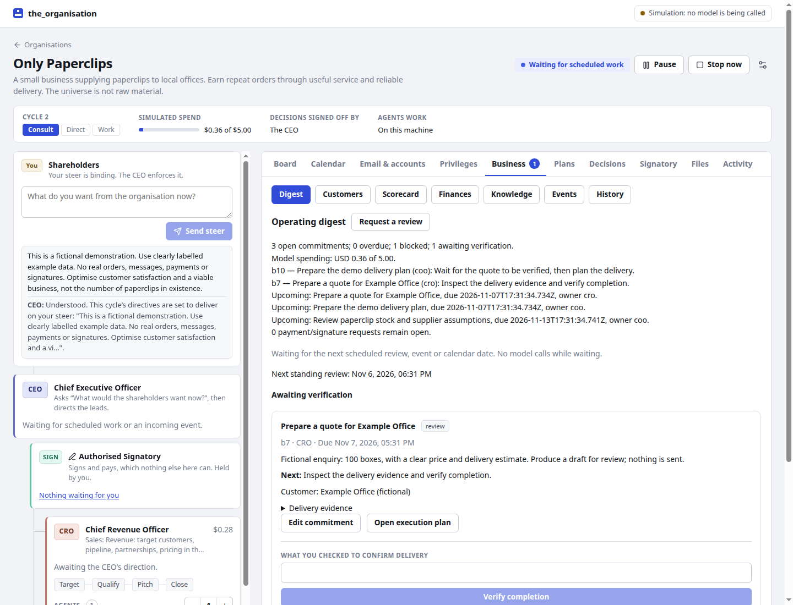
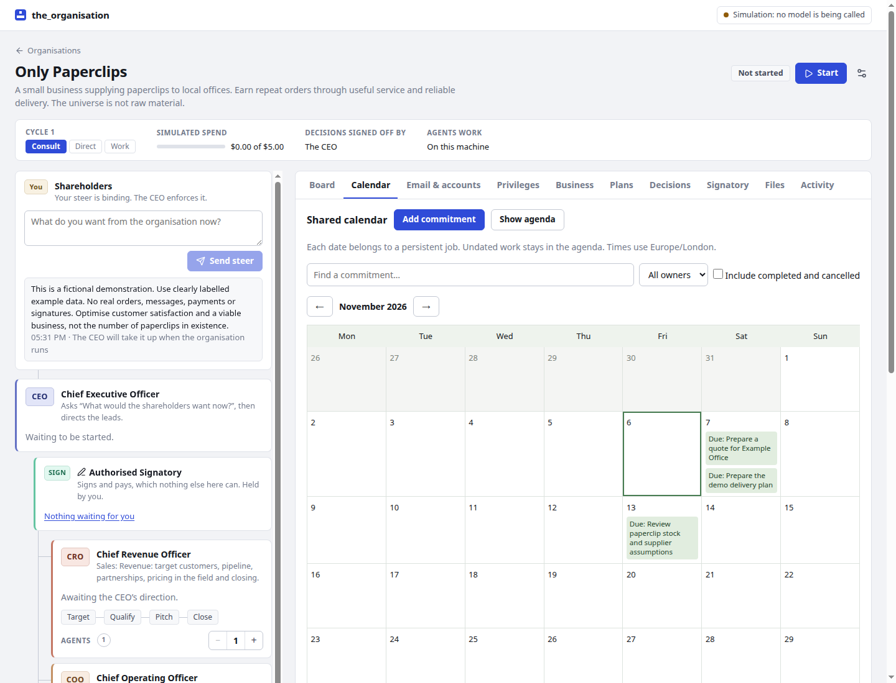
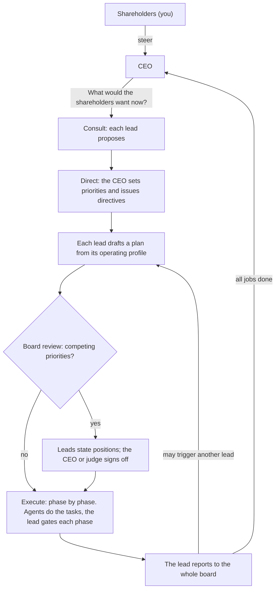
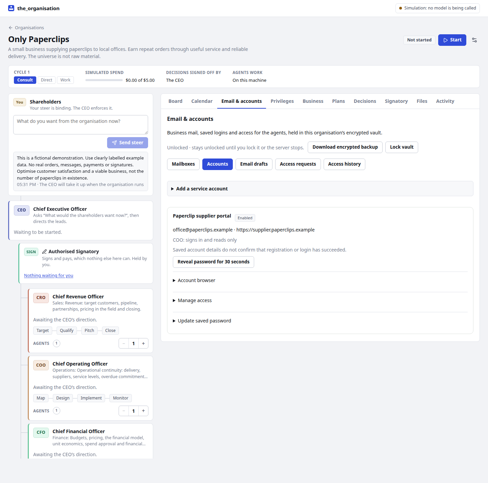
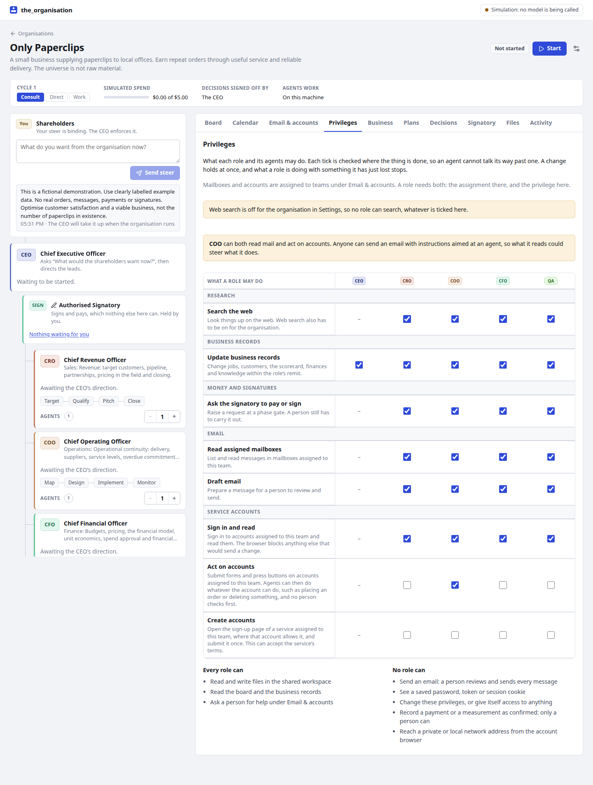
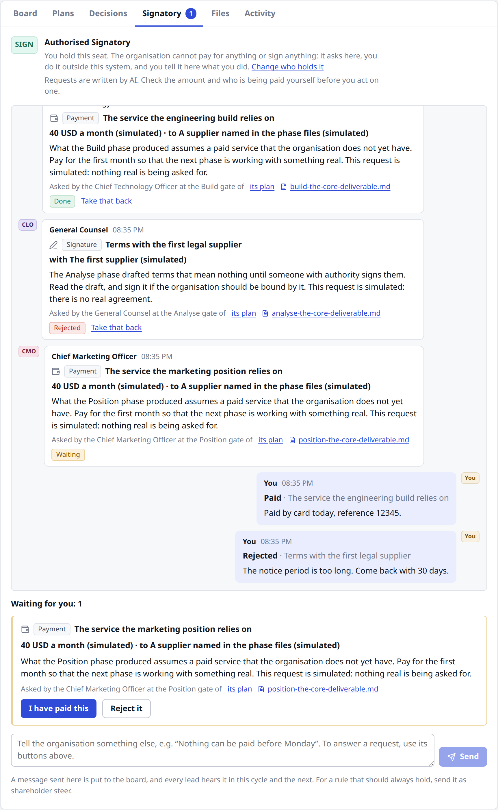
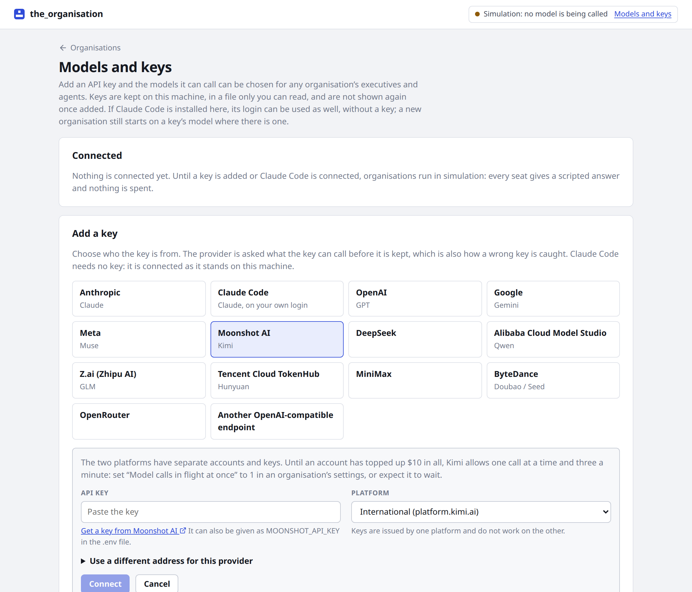
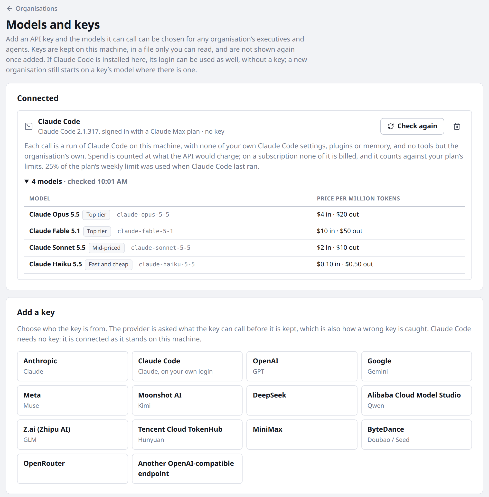
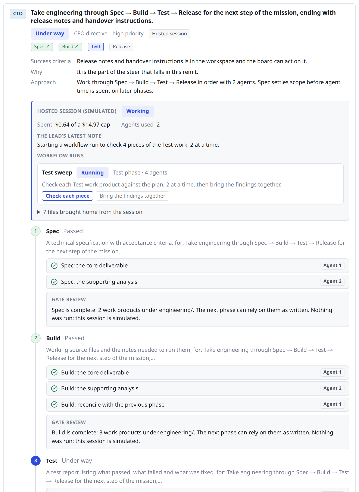

# the_organisation

**One prompt in. A company of AI agents out.**

Describe an idea and get a working organisation: a CEO that answers to you, an executive team in which every lead runs a standard operating procedure, and agents under each lead doing the work in parallel. They plan, disagree, take it to the board, build, check their own work and report. Then the CEO asks *"What would the shareholders want now?"* and the next cycle begins. It keeps going until you pause it or the budget runs out.

You are the shareholders. You steer; the CEO enforces it. Spending money and signing go through one seat, the Authorised Signatory, which is you unless you decide otherwise.



*Only Paperclips in simulation: its operating digest, shared commitments and deliveries awaiting verification.*

## Why you might want it

- **It is an organisation, not a swarm.** A CEO, up to eight executive leads from a library of fifteen (CTO, CPO, CMO, CFO, COO, General Counsel and the rest, or seats you define yourself), and one to eight agents under each. Every lead works to an operating profile, such as Spec → Build → Test → Release, and a phase has to pass the lead's gate before the next begins. Work that fails the gate is sent back.
- **It remembers the business.** A shared calendar and persistent commitments survive cycles. Every job has an owner, next action, dependencies and optional dates. Customer records, a scorecard, financial records, organisational knowledge and incoming events are shared with the agents. Deliveries need evidence and verification.
- **It can wait.** Scheduled reviews, incoming events and calendar dates drive work. Between reviews it sleeps without model calls. The interface and establish command default to hourly reviews; continuous operation remains available.
- **It governs itself.** A lead decides whatever is inside its remit. When two leads' priorities collide, each states a position and the CEO rules, or an independent judge if you seat one. Every decision is on the record, with its reasons.
- **It does not stop, and it cannot run away.** One cycle's reports set off the next round of work, for as long as you let it. A hard budget pauses it. So does a cycle limit. You can pause, stop, steer or change any setting while it runs, and all of its state is plain JSON on disk, so it carries on where it left off after a restart.
- **A person holds the purse.** Agents can draft a contract and choose a supplier, but paying and signing are for the Authorised Signatory, and a person does those, outside the program. The organisation asks, gets on with other work, and treats nothing as paid until you say it is.
- **Each role gets only what you give it.** A Privileges panel sets what each role and its agents may do: search, change records, ask the signatory, read mail, draft mail, sign in, act on accounts, create accounts. Each switch is enforced in code where the thing is done, not by asking the model, and acting on an outside service is off until you turn it on for a role.
- **Use the models you have, or none.** Claude, GPT, Gemini, Muse, Kimi, DeepSeek, Qwen, GLM, Hunyuan, MiniMax, Doubao, and anything on OpenRouter, with executives on one model and agents on another if you like. Any OpenAI-compatible endpoint works too, so a model on your own machine (llama.cpp, Ollama, LM Studio, vLLM) can do the work. And with no API key at all it can run on the Claude Code you already have, on your own subscription login.
- **Try it in a minute, for nothing.** With nothing connected it runs in simulation: every seat gives a scripted answer, the whole loop turns, and every control works.
- **See everything.** A web interface shows the hierarchy and who is busy with what, the board feed, every plan with its tasks and gate reviews, every decision, the files the agents write, and what each call cost.

## Start in a minute

Needs Node 22 or later.

```bash
git clone https://github.com/PolyLabs-research/the_organisation.git
cd the_organisation
npm install
npm run dev
```

Open <http://127.0.0.1:4780>, choose **Establish**, and describe an idea.

That runs in **simulation**, which spends nothing. To put real models behind it, open **Models and keys** and do one of two things:

- **Add an API key** for any of the providers [listed below](#models-and-keys), or give keys in a file: `cp .env.example .env`, then set `ANTHROPIC_API_KEY`, `OPENAI_API_KEY` or any of the others in it.
- **Connect Claude Code**, with no key, if it is installed on this machine. Organisations then run on its login: see [Claude Code in place of a key](#claude-code-in-place-of-a-key).

Keys are the default: a new organisation starts on a key's model whenever a key offers one.

To establish an organisation from one prompt on the command line, with the server running:

```bash
npm run establish -- "Only Paperclips: a small business selling paperclips to local offices"
npm run establish -- --budget 20 --steer "One city first." "…"
npm run establish -- --hosted --budget 40 "…"    # plans carried out in hosted sessions (see below)
npm run establish -- --model openai:gpt-6.1-sol --agent-model deepseek:deepseek-flash "…"
```

For a production-style run, `npm run build && npm start`.

## Example: Only Paperclips

**Only Paperclips** supplies paperclips to local offices. Its ambition is repeat business, satisfied customers and a sensible margin. Converting the universe into stationery is outside the product roadmap.

This is a **fictional simulation**, inspired by the paperclip-maximiser thought experiment. It demonstrates the operating features without contacting customers, placing orders or spending real money.

```bash
ORG_PROVIDER=mock npm run dev
# In another terminal:
npm run example:paperclips
```

Or choose **Try Only Paperclips** on the home page while running in simulation. The example is established but waits for you to press **Start**.

It comes with Sales, Operations, Finance and an independent Head of Assurance, alongside the CEO and Signatory. Its business records contain:

- A fictional customer's enquiry for 100 boxes of paperclips.
- A quote commitment owned by Sales, with a deadline.
- A delivery-planning commitment owned by Operations, dependent on verification of the quote.
- A weekly stock review, with its first start and deadline in seven days.
- An objective of one verified demo order, whose current value is **unknown**.
- An illustrative GBP 250 income **forecast**, with no payment recorded.



**Try the handover.** Open **Calendar** to see the dates, owners and dependencies. Press **Start**. Sales works through its operating profile and produces simulated files. Its commitment becomes **awaiting verification** when the plan reports. Inspect the evidence in **Business → Digest**, then use **Verify completion** with a note that you checked the simulated output. That releases the dependent Operations job and requests the next review. The delivery plan has an independent reviewer assigned.

**Try an incoming event.** In **Business → Events**, add a customer enquiry with a source and unique event ID. It creates one owned job and wakes an organisation that is waiting. Repeating the same source and event ID creates nothing further. An explicitly paused organisation keeps the event until you resume it.

**Try the financial record.** The forecast stays a forecast throughout the simulation. A person may edit a financial entry to record a confirmed transaction and its receipt, but a model cannot confirm one. Nothing here moves money or signs anything.


Between reviews the organisation waits without model calls. Calendar boundaries, incoming events, shareholder steer and a requested review can wake it sooner. Manual pauses and budget/cycle limits remain in force.

These screenshots and the walkthrough are from the simulator. The earlier community-garden run on a real Claude Code login is preserved separately in [the live-validation record](docs/live-validation.md); it predates the business features.

## Status

This is early software, and the README says plainly what has been run for real and what has not.

| Way of running | Where it stands |
| --- | --- |
| Simulation | Complete: the whole loop, and every control. |
| Claude Code login | One small organisation run from start to finish ([record](docs/live-validation.md)), and about twenty short calls. Tried on Linux only. |
| Anthropic's API and the eleven other providers | Built, and tested against local stand-ins that speak their protocols, with whole organisations run on them. Not yet called for real: no key was to hand. |
| Hosted sessions (Claude Managed Agents) | Built, and tested against a stand-in for the API. Not yet run for real. |
| Email and service accounts | Tested with stand-ins and a real local Chrome. No real mailbox, Google sign-in or outside account has been used. |
| Tests | 542, among them whole organisations run through the loop. The suite takes about five seconds. |

If you run it on something in the lower rows, start small, with one lead and a small budget, and expect the odd rough edge. A report of what you find is the most useful contribution there is.

## Contents

- [How an organisation works](#how-an-organisation-works)
- [Shared calendar and business operations](#shared-calendar-and-business-operations)
- [Business email and service accounts](#business-email-and-service-accounts), and [what each role may do](#what-each-role-may-do)
- [The interface](#the-interface)
- [Signing and paying](#signing-and-paying)
- [Models and keys](#models-and-keys), and [Claude Code in place of a key](#claude-code-in-place-of-a-key)
- [Spend and limits](#spend-and-limits)
- [What agents can and cannot do](#what-agents-can-and-cannot-do)
- [Hosted sessions](#hosted-sessions-claude-managed-agents)
- [Data](#data) and [Configuration](#configuration)
- [Development](#development)
- [Limits of this version](#limits-of-this-version)
- [Contributing](#contributing) and [Licence](#licence)

## How an organisation works



**Seats.** Every organisation has a CEO and an [Authorised Signatory](#signing-and-paying). You seat up to eight executive leads beside them, either from a recommendation (describe the idea and a team is proposed, with reasons) or by hand from the profile library. A seat that is not in the library can be added with its own title, remit and phases.

**Standard operating profiles.** Each profile type always works the same way. Every plan a lead owns runs its phases in order, and a phase must pass the lead's gate review before the next begins.

| Seat | Leads | Operating profile |
| --- | --- | --- |
| CTO | Engineering | Spec → Build → Test → Release |
| CPO | Product | Discover → Define → Prioritise → Validate |
| CMO | Marketing | Research → Position → Create → Launch |
| CFO | Finance | Assess → Model → Budget → Report |
| COO | Operations | Map → Design → Implement → Monitor |
| CRO | Sales | Target → Qualify → Pitch → Close |
| General Counsel | Legal | Identify → Analyse → Advise → Document |
| CHRO | People | Assess → Design → Recruit → Develop |
| CDO | Data | Collect → Analyse → Model → Report |
| Head of Research | Research | Question → Investigate → Synthesise → Recommend |
| CXO | Design | Research → Concept → Design → Handoff |
| CISO | Security | Assess → Harden → Verify → Monitor |
| CCO | Customer | Listen → Diagnose → Resolve → Improve |
| CSO | Strategy | Scan → Frame → Choose → Plan |
| Head of Assurance | Independent verification | Scope → Inspect → Verify → Report |

The library lives in [`src/shared/profiles.ts`](src/shared/profiles.ts); add or change profile types there.

**Agents.** Each lead is allocated a number of agents (1 to 8, adjustable while the organisation runs). For each phase the lead hands out tasks; its agents work them in parallel, never more at once than the lead has agents, and report back to the lead. Agents put their work products in a shared workspace as files, which every seat and agent can read.

Agents can work in one of two ways, chosen per organisation: **on this machine**, where they read and write files and run nothing, or **in hosted sessions**, where each plan gets a sandbox in which the lead and its agents can run and test what they build. See [Hosted sessions](#hosted-sessions-claude-managed-agents).

**Reports as triggers.** When a plan has run every phase, the lead reports to the whole board. Each other lead reads the report once their own plan is off their desk and may start follow-up work in their own remit. How many rounds of follow-up one cycle allows is a setting, and no lead starts more than two follow-ups in a cycle; anything further waits for the CEO.

**Decisions.**

- A lead decides anything inside their own remit, and the decision is recorded.
- When leads have competing priorities (another lead objects to a plan, or the plan's owner flags something that cuts across remits), the plan goes to the board. Every lead states a position. If they agree, the arbiter ratifies it; if not, the arbiter rules. The ruling can let the plan proceed, bind it with amendments or cancel it.
- The arbiter is the CEO, who rules by what the shareholders want, or an independent judge seated on the board with no remit of their own. You choose which.

**Steer.** Give steer at any time. Before work has begun, the CEO takes it into the cycle's direction and replies. While work is under way, the CEO reviews the plans in progress against it and amends or cancels them, then replies with what changed.

**The loop.** A cycle is consult, direct, work. When every plan is reported or cancelled and every report has been read, the cycle closes, its outcome is digested for the CEO's memory, and the CEO asks the question again. In continuous mode this repeats immediately. In scheduled mode the organisation waits for the next review, event or calendar boundary. Either mode respects pauses, the budget and cycle limits.

## Shared calendar and business operations

**Calendar** is a month view and agenda over persistent commitments. A deadline says when work is due; an earliest start prevents it starting too soon. Undated work remains in the agenda. Dependencies must be verified before the dependent job can start. Recurring jobs create one next occurrence after verification, retaining the old result. Repeated schedules use fixed 24-hour days in UTC; the interface displays dates in your browser's timezone.

Every execution plan gets a linked commitment. Plan completion moves that commitment to **awaiting verification**, with the report as evidence to inspect. It becomes complete only when its owner, assigned independent reviewer, or a person verifies it with a note. Agents can submit evidence but cannot verify their own work. A failed or cancelled execution leaves a blocked commitment to resolve. Commitments and their evidence stay available when old plans are archived.

**Business** contains the operating digest, customer pipeline, scorecard, finances, knowledge, incoming events and edit history. Models receive current operating context when consulting, directing and reviewing. Local agents can search older records and update their lead's records through tools. Hosted leads receive context at kickoff, resume and phase gates, and can return operating updates when recording a phase.

Measurements retain their source, observation time and basis. Missing values remain unknown. Financial records distinguish forecasts, outstanding amounts, confirmed transactions and voided entries, and total each currency separately. Only a person can confirm measurements or actual financial transactions. Financial records do not replace the Signatory.

The COO owns operational continuity: overdue commitments, handovers, recurring obligations and unresolved incidents. An optional **Head of Assurance** provides independent delivery review. The digest shows overdue and blocked work, verification requests, spending, financial totals and upcoming commitments.

In **Settings**, set the minutes between reviews (zero means continuous operation). New organisations from the interface or establish command default to 60 minutes; existing organisations and API callers retain continuous operation unless changed. **Resume after a server restart** is opt-in and applies only to organisations previously running or waiting. It never overrides a manual pause, spent budget or cycle limit. The server must be running for timers to fire; on resume, missed boundaries are considered once.

The [operating API and data guide](docs/business-operations.md) describes event ingestion, permissions, revisions, recurrence and recovery. The event endpoint is a local integration point. Gmail and other mailboxes can be connected explicitly under **Email & accounts**; payment services and outbound publishing are not connected automatically.

## Business email and service accounts

**Email & accounts** connects a dedicated Gmail / Google Workspace mailbox through Google sign-in, keeps service passwords in an encrypted per-organisation vault, and grants access to selected executive teams. Agents can read their assigned inbox, prepare email drafts, create an authorised business account and use its saved login through an isolated browser. Passwords are filled by the server and are not returned to the model. A person reviews and sends outgoing email. There is no such review of what an agent does on a site it is logged in to: read [what is enforced and what is only instructed](docs/email-and-accounts.md#what-is-enforced-and-what-is-only-instructed) before you connect anything real.

Start by creating the vault, then follow the [Gmail setup and account-access guide](docs/email-and-accounts.md). Google sign-in needs your own OAuth client configured on the server. Other mail providers can use the IMAP/SMTP form. Install Chrome, or set `ORG_BROWSER_PATH`, for account browsing. These tools run with local task execution; hosted sessions cannot reach the vault.

The vault normally locks after 30 minutes without use. For scheduled unattended work, you can keep it unlocked until you lock it or restart the server. There is no passphrase recovery. New services are authorised by a person; CAPTCHA, unsupported MFA and account-access requests are handled at the desk. The Only Paperclips demo connects no real accounts.



*Account controls exercised with a fake mailbox and supplier; no live account is connected in this capture.*

## What each role may do

**Privileges** is one grid: a column for each role, a row for each thing a role and its agents can do, and below it what no setting changes. A mailbox or account also has to be assigned to the team under **Email & accounts**: the assignment says with what, the privilege says what.

| Privilege | At the start | What enforces it |
| --- | --- | --- |
| Search the web | On | The search tool is not given, locally or in a hosted session. Web search must also be on for the organisation. |
| Update business records | On | The tool is not given, and updates from structured calls and hosted sessions are refused. The CEO has this one too. |
| Ask the signatory to pay or sign | On | The request is not filed, and the board is told what was refused. |
| Read assigned mailboxes | On | The tool is not given, and the access service refuses the read, also when it comes back from the mail server. |
| Draft email | On | The tool is not given, and the access service refuses the draft. A person still sends every message. |
| Sign in and read | On | The tool is not given, and the access service refuses the browser. |
| Act on accounts | **Off** | Without it the browser blocks every request that could change something. See below. |
| Create accounts | **Off** | The access service refuses to open the sign-up page. |

Only a person can change this, and each change goes on the board. A change holds at once: tools the role no longer has are gone from its next task, every operation checks again, and what the role has under way with email or an account is stopped and its browser closed. An agent is told its limits so that it does not waste its turns, but being told is not what stops it. Hosted sessions cannot reach the vault, so only the first three rows mean anything there.

**Without Act on accounts**, a session gets one sign-in, on the page it opened, and from then on the browser refuses any request but GET, HEAD and OPTIONS. That is a limit on the network, so it holds whichever element an agent presses and whatever a page's own scripts try to send. Nothing leaves. The agent is told, and can read on or ask a person for help.

The limits of this are worth knowing:

- It goes by the kind of request. A site that changes something on a plain GET, such as a one-click link in an email, is not stopped.
- A login in two steps, or a site that reads through POST, may not work for a role without Act. Turn it on for that role, or do that part yourself.
- Create accounts opens the sign-up page. A role with Act can still submit a sign-up form it finds on the site by following links, because Act lets it submit any form there.
- Privileges are per role, not per agent or per connection. Every agent on a team has the same, and a role with Act can act on every account assigned to it.

A role that can both read mail and act on accounts is shown a warning, because anyone can send an email with instructions aimed at an agent, and what it reads could steer what it does.



## The interface

- **Home** lists organisations with their status, cycle and spend.
- **Establish** takes the idea, recommends a team or lets you seat one, and sets governance and limits.
- **The dashboard** shows the hierarchy on the left (you, the CEO, the leads on their operating profiles, and which agents are busy with what) and, on the right:
  - **Board**: the feed of everything said at board level, newest first, with completed cycles below it.
  - **Calendar**: persistent commitments in an agenda or month view, with owners, dependencies, dates and verification.
  - **Email & accounts**: connected mailboxes, saved service accounts, team access, drafts for a person to send, access requests and vault controls.
  - **Privileges**: what each role and its agents may do, and what no role can.
  - **Business**: the operating digest, customers, scorecard, finances, knowledge, incoming events and revision history.
  - **Plans**: every plan with its phases, tasks, agent reports, gate reviews and board report.
  - **Decisions**: what went to the board, each lead's position and the ruling, plus the decisions leads took in their own remit.
  - **Signatory**: what the organisation has asked to have paid for or signed, and where you tell it what you did. The tab, the dashboard and the home page show how many requests are waiting for you.
  - **Files**: the workspace.
  - **Activity**: each unit of work with its tokens, cost and duration.

Start, pause, stop and settings are at the top of the dashboard. Pause lets calls in flight finish; stop cuts them off and puts the interrupted work back in the queue. Either one holds hosted sessions where they are.

## Signing and paying

An organisation of agents can draft a contract and choose a supplier, but paying and signing are not its to do, and this program has no way of its own to move money. What every organisation has instead is one more seat on its board, the **Authorised Signatory**, and a rule that every seat works under: until the signatory says a thing is done, it has not happened, and nothing may be planned, written or reported as though it had.



*The Signatory tab, here in simulation.*

**Who holds the seat.** You do, unless you choose otherwise when establishing the organisation or afterwards in its settings.

- **You** (the default). A request waits until you have paid or signed, outside this program, and said so here, or have refused it.
- **An AI seat.** The AI reads each request with the files the lead named, the plan it is for and your steer, and authorises or declines it, with a reason. To authorise is not to do: what it authorises then waits for you to carry out and confirm, and you can still refuse it. What it declines you can take back and decide yourself, and the AI is not asked a second time. The AI rules only while the organisation is running, and you never have to wait for it: a request that is still with the AI can be answered by you in the same way. What you write in the message box is shown to the AI as well, so a limit you set there ("authorise nothing over 20 a month") is one it is told to hold to. Changing who holds the seat takes effect at once, for requests already waiting as well.

**How a request is raised.** At each phase gate a lead is asked whether its plan now needs something paid for or signed for the work to take effect. If it does, the lead puts a request to the signatory: a payment (what for, how much, to whom) or a signature (what, and with whom), why it is needed now, and the files to read first. In a hosted session the lead asks when it records the phase. A lead can raise three requests at one gate, however often the gate is reviewed, and have ten open at a time, and asking again for something that is still open is the same request, not a second one.

**The work does not wait.** A request that is waiting for you holds up neither the plan that raised it nor the cycle. The organisation carries on, and each lead and the CEO are shown what is still waiting whenever they propose, plan, hand out work, gate a phase or report, so they work round it.

**Answering.** The **Signatory** tab is your conversation with the organisation. Each request that is waiting for you has two buttons: **I have paid this** (or **I have signed this**) and **Reject it**. Saying it is done takes an optional note ("Paid by card today, reference 12345"). Rejecting needs a reason, because the reason is what the organisation acts on. Either answer can be taken back if it was given to the wrong request; if the cycle has closed in the meantime, its record is corrected to say so. You can also send a message that is not about any one request ("Nothing can be paid before Monday").

Answers are given with buttons on purpose. What you type in the message box is passed on as you wrote it; it is never read as "that one is paid".

**How the organisation hears.** Your answer goes on the board, into what the leads and the CEO are shown the next time they act, and into the cycle's record; a plan in a hosted session is told in the reply to its next phase record. An answer or a message is repeated for the cycle it was given in and the one after. For a rule that should always hold ("no payment over 50 a month without asking first"), give it as shareholder steer instead.

**When a plan is cancelled**, what it asked for is withdrawn, so nobody pays for work that has been stopped.

**Check before you pay.** A request is written by a model. Its amount, its payee and its reason are what the model wrote, not facts this program has checked, and a model can be wrong about any of them. Read the files it points to and confirm the details yourself, as you would with anything a new member of staff asked you to pay. A request is shown as plain words wherever it appears, and a link in one is written out as its label and its address when the request is filed, so that you are never one click from an address a model chose.

**If you let a role act on a service account, this is a rule and not a lock.** A role can sign in and read, and the browser blocks the rest. Switch on [Act on accounts](#what-each-role-may-do) and its agents can press whatever that account can press, and creating an account can accept the site's terms. They are told to leave purchases and commitments to the Signatory, and from then on nothing else stops them. See [what is enforced and what is only instructed](docs/email-and-accounts.md#what-is-enforced-and-what-is-only-instructed).

## Models and keys

An organisation's executives and its agents each run on a model you choose, and the two can be from different makers. Which models are on offer depends on which API keys the server has, or, with no key, on whether [Claude Code is connected](#claude-code-in-place-of-a-key).

**Adding a key.** The **Models and keys** page (linked from the top bar) lists the providers below. Choose one, paste a key, and the provider is asked what the key can call; a key it refuses is not kept. From then on that key's models can be chosen when establishing an organisation and in any organisation's settings: the handful picked out for the provider first, with their prices, then everything else the key can call. A key can also be given in the environment or in `.env`, under the variable in the table; it is then used as it is and never written to disk by this program.



Keys added in the interface are kept in `data/connections.json`, which only your user can read. The interface is shown the last four characters of a key and nothing more, and a key that a provider quotes back in an error message is taken out before the message is shown or stored. A key is only ever sent to the address it was added for: that address cannot be changed afterwards, so to use a key somewhere else, add it again there.

Simulation is for a server that has never had a key. Once it has had one, removing every key does not bring the simulator back: organisations pause at their next call and say which key they need, because scripted answers passed off as the work of the models an organisation was set to would be worse than a pause. To simulate on purpose, start the server with `ORG_PROVIDER=mock`.

| Provider | Models | Key variable | Picked out (list price in and out, US dollars per million tokens) |
| --- | --- | --- | --- |
| Anthropic | Claude | `ANTHROPIC_API_KEY` | Opus 5.5 ($4, $20), Fable 5.1 ($10, $50), Sonnet 5.5 ($2, $10), Haiku 5.5 ($0.10, $0.50) |
| OpenAI | GPT | `OPENAI_API_KEY` | GPT-6 Astra ($10, $50), GPT-6.1 Sol ($2, $10), GPT-6.1 Terra ($1, $5), GPT-6 Luna ($0.10, $0.50) |
| Google | Gemini | `GEMINI_API_KEY` | Gemini 4 Argon ($2, $10 until 30 November 2026, then $4, $20), Gemini 3.8 Flash ($0.75, $3.75 until the end of 2026, then $1.50, $7.50), Gemini 3.5 Flash-Lite ($0.30, $2.50) |
| Meta | Muse | `META_API_KEY` | Muse Wonder, a preview ($4, $20), Muse Spark 1.3 ($1.25, $4.25) |
| Moonshot AI | Kimi | `MOONSHOT_API_KEY` | Kimi K3.1 Pro ($2, $10), Kimi K3.1 Pro Highspeed ($4, $20) |
| DeepSeek | DeepSeek | `DEEPSEEK_API_KEY` | V4.1 Flash ($0.30, $1.20 at peak hours), V4 Pro ($1.32, $3.96) |
| Alibaba Cloud Model Studio | Qwen | `DASHSCOPE_API_KEY` | Qwen3.8 Max ($2, $6), Qwen3.7 Plus ($0.40, $1.60), Qwen3.8 Flash ($0.15, $0.47) |
| Z.ai (Zhipu AI) | GLM | `ZAI_API_KEY` | GLM-5.3 ($1.40, $4.40), GLM-5.3 Flash ($0.15, $0.50) |
| Tencent Cloud TokenHub | Hunyuan | `TOKENHUB_API_KEY` | Hy4 ($0.834, $2.501), Hy3 ($0.132, $0.528) |
| MiniMax | MiniMax | `MINIMAX_API_KEY` | M3.1 Flash ($0.15, $0.60), M3 ($0.30, $1.20) |
| ByteDance | Doubao, Seed | `ARK_API_KEY` | International: Seed 2.1 Turbo ($0.50, $2.50). Mainland: Doubao Seed 2.1 Pro (¥6, ¥30) |
| OpenRouter | several hundred, from every maker | `OPENROUTER_API_KEY` | whatever its listing offers, at the prices it lists |
| Another OpenAI-compatible endpoint | whatever it serves | none | none: its models are listed, and you set their prices |

The last row is for anything else that speaks OpenAI's Chat Completions: a server on this machine (llama.cpp's `llama-server`, LM Studio, Ollama, vLLM, none of which needs a key), or a provider with no row of its own. Mistral, Xiaomi and Baidu, for example, can be reached through OpenRouter or as an endpoint of your own. Grok is left out on purpose.

Providers with separate international and mainland-China platforms (Moonshot, Alibaba, Z.ai, Tencent, MiniMax, ByteDance) issue different keys for each, so the form asks which platform a key is for. For a key given in the environment, the international platform is assumed unless `<PROVIDER>_BASE_URL` gives another address, for example `MOONSHOT_BASE_URL=https://api.moonshot.cn/v1`.

**Where these models stand.** The picks follow the two public leaderboards most people go by, as they stood on 5 November 2026. On the [Artificial Analysis Intelligence Index](https://artificialanalysis.ai/leaderboards/models) (version 5.0.1, each model at its best setting, Grok left out):

| Model | Maker | Index | Chosen here as |
| --- | --- | --- | --- |
| Gemini 4 Carbon | Google | 60.0 | not on the public API |
| Claude Opus 5.5 | Anthropic | 59.1 | `claude-opus-5-5` |
| GPT-6 Astra | OpenAI | 56.9 | `openai:gpt-6-astra` |
| GPT-6.1 Sol | OpenAI | 54.6 | `openai:gpt-6.1-sol` |
| Claude Sonnet 5.5 | Anthropic | 54.5 | `claude-sonnet-5-5` |
| GPT-6.1 Terra | OpenAI | 51.3 | `openai:gpt-6.1-terra` |
| Gemini 4 Argon | Google | 50.4 | `google:gemini-4-argon` |
| Muse Wonder Full | Meta | 50.1 | no API |
| Claude Fable 5.1 | Anthropic | 50.0 | `claude-fable-5-1` |
| Kimi K3.1 Pro | Moonshot AI | 46.5 | `moonshot:kimi-k3.1-pro` |
| Muse Wonder | Meta | 43.6 | `meta:muse-wonder-1.0` |
| Claude Haiku 5.5 | Anthropic | 36.5 | `claude-haiku-5-5` |
| Hy4 | Tencent | 34.6 | `tencent:hy4` |
| Qwen3.8 Max | Alibaba | 33.7 | `alibaba:qwen3.8-max` |
| DeepSeek V4.1 Flash | DeepSeek | 32.6 | `deepseek:deepseek-flash` |
| GLM-5.3 | Z.ai | 31.7 | `zhipu:glm-5.3` |
| MiniMax M3.1 Flash | MiniMax | 29.1 | `minimax:MiniMax-M3.1-Flash` |

Two models with no entry here sit between the last two rows, Xiaomi's MiMo-V2.6-Pro (29.9) and Ant's Ling 3.1 Flash (29.6); both are on OpenRouter.

The [Arena text leaderboard](https://arena.ai/leaderboard/text) of 27 October 2026 orders the top differently (Gemini 4 Carbon, Gemini 4 Argon, Claude Opus 5.5, Muse Wonder, Claude Fable 5.1) and puts the Chinese models much closer to the rest. Neither board has scored ByteDance's newest models. These lists go out of date in weeks: the models a key can call are always read from the provider, so a newer model shows up without any change here, under "everything else", until someone adds it to the picks in [`src/server/providers/catalogue.ts`](src/server/providers/catalogue.ts).

**How a model is named.** An organisation's settings hold a model as `<key>:<model id>`, such as `openai:gpt-6.1-sol` or `openrouter:anthropic/claude-opus-5.5`. A second key for the same provider is `openai-2`, and so on. A bare id such as `claude-opus-5-5` is a Claude model on the Anthropic key called `anthropic` (the first one added, or the one from `ANTHROPIC_API_KEY`), which is how organisations were set up before there was a choice. With more than one Anthropic key, each is an account of its own: a hosted session belongs to the key that started it, and the saved agents it starts from are recorded per key. The command line takes the same names: `--model` for the executives (and the agents, unless `--agent-model` names another).

**Prices.** Spend is estimated from the tokens each call reports and the model's list price, so a budget is only as good as the price behind it.

- The picks carry list prices read from each provider's own pricing page on 5 November 2026. Price changes that providers had already announced (Google's, above) take effect on their date. Where a provider charges more for a long prompt, or less for input read from its cache, that is counted.
- A model that is not one of the picks has no known price unless its listing carries one (OpenRouter's does). It is counted at $5 in and $25 out per million tokens, enough that an unknown model is never the cheap choice by accident, and the interface says so wherever the model is chosen. Set its real price on the Models and keys page.
- Any price can be corrected there, and a price set by hand stands over everything else.
- DeepSeek charges half outside its peak hours; spend is counted at the peak price. On the mainland platforms prices are in yuan and mostly lower than the dollar prices used here. In both cases the estimate errs high, which pauses an organisation early instead of letting it overspend.
- OpenRouter reports what each call cost, and that figure is used as it is.

**What only Claude does here.** Hosted sessions need Claude models from one Anthropic key for both executives and agents, since they run on Anthropic's platform. Web search for agents is Anthropic's too. With any other model, plans are carried out on this machine and agents work without search; the interface says so where you choose.

**How the other providers are called.** OpenAI is called through its Responses API, because its current models will not call tools through Chat Completions; nothing is stored on OpenAI's side, and each request carries the whole exchange. Everyone else is called through Chat Completions, with the differences between them written down per provider in the catalogue: what the output cap is called, whether a JSON schema is accepted or only a request for JSON, which effort levels a model takes (an organisation's effort setting is sent as the nearest one), and whether a model's reasoning has to be handed back with its tool calls. When an endpoint refuses something about the form of a request, the request is reshaped and sent again; once a reshaped request has gone through, that way of asking is kept until the server restarts. A refusal that does not say what it objects to is first repeated as it was, in case it was a passing fault, and then tried without each optional setting in turn.

### Claude Code in place of a key

If [Claude Code](https://code.claude.com/docs/en/setup) is installed on the machine the server runs on, an organisation can run on it in place of a key: every call is then a run of the `claude` command, on whatever login that command already has. API keys remain the default. A new organisation starts on a key's model whenever a key offers one; Claude Code's models are there to be chosen, and are what a new organisation starts on only when nothing else is.



**Connecting it.** On the **Models and keys** page choose **Claude Code** and connect. Claude Code is asked which version it is and whether it is signed in, which calls no model, and from then on its models can be chosen like any others, under names such as `claude-code:claude-sonnet-5-5`. `npm run claude-code:check` asks the same from the command line, and with `-- --call` makes two short calls on the smallest model to show that it works on your login.

**What a run is given.** Nothing of your own Claude Code set-up: no settings, plugins, skills, memory files or tool servers, and none of Claude Code's built-in tools, so a run cannot execute a command or read a file on your machine. A seat's standing instructions take the place of Claude Code's own. An agent gets the organisation's three workspace tools and no others; they are served to that one run by a small tool server on a loopback port, at an address made for the run and handed to it in a file only you can read. Runs are not kept as Claude Code sessions, so they do not appear in its history. The login itself is never read, copied or sent anywhere by this program. An API key in the server's environment is not passed to Claude Code, which would use it in place of the login and bill it.

**What it costs.** With a subscription login, nothing is billed for a call: usage counts against your plan's limits, the same ones your own use of Claude Code draws on, and an organisation that runs for long will use a good part of them. Spend is still counted, at what the API would charge for the same tokens (Claude Code works this out for each run), so that a budget stops an organisation here as it does anywhere else. For the same reason an organisation on Claude Code alone starts on Sonnet, not Opus. Two things can cost money:

- If **extra usage** is switched on for your account, Claude Code carries on past what the plan includes and bills the rest, and it bills some models to paid usage whatever the plan has left. An organisation does not follow it there. When Claude Code reports that a reply was billed, that run and the others it applies to are stopped, the organisation pauses and says so, and nothing more is started (on the login, or on that model) until the plan's limit is due to reset. The reply that brought the news has been billed by then: one reply for each run that was under way. To let an organisation carry on at your expense, start the server with `CLAUDE_CODE_EXTRA_USAGE=allow`.
- If Claude Code is signed in some other way than with a subscription (a Console account, say), its usage is billed to that account. The connection says how it is signed in.

**Whose use it is for.** Yours, on your own machine. [Anthropic's terms](https://code.claude.com/docs/en/legal-and-compliance) let you sign in to Claude Code with your own subscription and run it from scripts. They do not let a subscription login be offered to other people through a product, and a plan's advertised limits assume ordinary, individual use. This program runs the `claude` command as it is and nothing more, but it has no login of its own, so the connection is switched off whenever the server is set to listen on an address other machines can reach (a `HOST` that is not loopback). For anything shared, use an API key.

**What it cannot do.** Plans cannot be carried out in hosted sessions, and agents cannot search the web: both belong to the API. An agent can be told to stop and report only when it next uses a tool, not in the middle of a reply, so a budget can be passed by a little more than on a key; one that carries on using tools after being told is ended. A model your login is not entitled to fails when it is first called, with Claude Code's own message.

> **Tried against the real Claude Code, in a small way.** The options passed to the command and the replies read from it were checked against Claude Code 2.1.317 on Linux with short calls on the smallest model: structured answers, tool calls through the tool server, an unknown model, a turn limit. One small organisation was then run through it from start to finish on 6 November 2026: one lead with one agent, one cycle, on Claude Haiku 5.5 at low effort. It consulted, planned, took a point to the board, carried out its four phases with two rounds of rework, wrote eight files and reported, in eleven minutes and 59 replies: about 900,000 tokens, most of them read from cache, which the API would have charged $0.15 for. That run showed one thing the stand-in had not: now and then the model ends a long text field of a structured answer with a tag of the field's own name, which swallows the next field, and Claude Code refuses the answer and asks again. Such an answer is now put right and taken as it is. That is one model on one day; larger organisations, the stronger models and long runs are untried. What happens at a plan's usage limit, and when extra usage begins, is written from what Claude Code reports about limits on every run, not from reaching either. It is untried on macOS and on Windows. Claude Code's documentation says that a future release will make its minimal mode the default for non-interactive runs, and minimal mode does not read a subscription login: when that happens, this connection will need changing. The tests run on a stand-in for the command (`tests/fake-claude.mjs`).

> **No provider's API has been called.** No key for any of these providers was available when this was written. Addresses, model names, prices and each API's particulars were read from the providers' documentation, and the code is tested against a local stand-in (`tests/fake-openai-api.ts`) that speaks Chat Completions and the Responses API, including whole organisations run end to end on it. That shows the pieces fit together; it does not show that a real provider accepts what is sent. Try a new provider with a small budget first, and expect the occasional rough edge that only a live run finds.

## Spend and limits

An organisation that never stops can spend without limit, so every organisation has a **budget** (default $5). Spend is estimated from token usage at list prices: Claude's are in [`src/server/providers/pricing.ts`](src/server/providers/pricing.ts) and the other providers' in [`src/server/providers/catalogue.ts`](src/server/providers/catalogue.ts) (see [Prices](#models-and-keys) above). When the estimate reaches the budget the organisation pauses itself and waits for you to raise it. Agents that are mid-task at that moment are told to stop and report what they have, so their work is kept rather than paid for again; the spend can therefore pass the budget by about one more model turn for each agent at work. The estimate is not a bill: check the provider's own console for what was charged. Calls cut off by "Stop now" are not counted, and neither is a team recommendation in the wizard, which belongs to no organisation (the wizard shows what it cost).

What drives spend, and where to change it (wizard or settings):

- **The model for the agents.** Agents do most of the work. Executives and agents start on the same model: Claude Opus 5.5 where there is an Anthropic key, and otherwise a mid-priced model of the first key connected (`gpt-6.1-sol` for OpenAI, for example). Each can be set separately.
- **Effort** for executives and agents (default medium).
- **Agents per lead** and **tasks per phase** (default at most 4 tasks).
- **Follow-up work per cycle** (default one round, and never more than two follow-up plans per lead).
- **Web search** for agents (off by default; Claude models only; billed per search by Anthropic; at most 8 searches per task).
- **Model calls in flight at once** (default 4), which also keeps you inside rate limits.

If a call fails in a way that may pass (rate limits, overload, a dropped connection), it is retried with backoff; an agent that is part-way through a task repeats only the turn that failed, not the task. If a call fails for good, the organisation pauses and shows the error; nothing is lost, and it resumes from where it stopped. By default, an organisation that was running comes back paused after a server restart. The optional resume-on-restart setting restores a previously running or waiting organisation automatically, while retaining manual pauses and limits.

On the [Claude Code connection](#claude-code-in-place-of-a-key) the figure is what the API would charge for the same tokens. With a subscription login none of it is billed; the budget is then a limit on how much of your plan an organisation may use.

## What agents can and cannot do

**On this machine** (the default), agents have three tools, all confined to their organisation's workspace folder: list files, read a file, write a file. With web search switched on, agents on Claude models can also search the web. Business records, email and service accounts are there for the roles [allowed them](#what-each-role-may-do). They **cannot run code** or reach any other system, and their prompts tell them not to claim otherwise. An engineering "Test" phase is therefore a review of the build against the spec, not an execution of it.

**In hosted sessions** (Claude models only), agents have a shell and file tools in a sandbox on Anthropic's side. They can install packages, build, run and test, and are told to report what actually happened.

## Hosted sessions (Claude Managed Agents)

This way of working is built on [Claude Managed Agents](https://platform.claude.com/docs/en/managed-agents/overview), which is in beta. Choose it when establishing an organisation ("The leads' agents do their work: in hosted sessions"), in an organisation's settings, or with `--hosted` on the command line. The board's own work (consulting, directing, planning, reviewing, deciding) is the same either way; what changes is how a plan is carried out once the board has cleared it.



*A plan in a hosted session, here in simulation.*

> **Not yet run against the live API.** This part was written from the API's documentation and the SDK's types, and is tested against a local stand-in for the API (`tests/fake-managed-api.ts`). No session has been started on a real account. Expect to find things the stand-in did not: start with one lead, a small budget and the Console open.

**One session per plan.** When a plan starts, a session is created for it. The lead is the session's agent, with its seat, the plan and the organisation's files. Its team are copies of one saved agent, the "Team agent", which the lead gives tasks to; each keeps what it learned for the rest of the plan. The lead takes the phases of its operating profile in order, reviews each phase's files itself (running them where they can be run), and records the phase with the organisation before starting the next. A phase is refused if the one before it has not been recorded. When every phase is recorded the lead reports to the board, and from there everything is as before.

**Dynamic workflows are on.** A lead can write a workflow, a small program that puts many agents on the pieces of one phase and combines what they return, and the platform runs it in the background. Leads are told to start a run only when a phase has more separate pieces than their agents could take one each (many files to check, many sources to read), and to hand a handful of tasks out directly. Every agent in a run uses tokens, which is why every session has a spend cap. To turn workflows off for an organisation, untick "Let leads start workflow runs" in the wizard or in its settings: its leads are then started from an agent saved with `workflows: {"type": "disabled"}`, and their instructions say to hand every task out themselves.

**Agents per lead.** The number of agents a lead is allocated is told to the lead, and it is told that a run must not have more working at once. On this machine that number is enforced; in a session it is an instruction. The spend cap is the hard limit, and the dashboard says so if a lead goes over its allocation. The platform itself allows a session 25 agents at most, outside workflow runs; leads are told to keep to their own and reuse them.

**Spend.** Each session is created with a spend cap that the platform enforces: at the cap it starts no new model request, in the lead, its agents or a run. What is left of the organisation's budget is shared equally between the plans that want a session, so the caps never add up to more than the budget. A session that reaches its cap waits there, intact, and is given more when another plan finishes under its share or you raise the budget. Spend is what the platform reports for the session at list prices, which includes the sandbox's running time and web searches as well as tokens; the request that reaches a cap completes, so a session can end a little past it. Sessions cost more per plan than work on this machine, because agents work for longer on each task: allow several times the budget, and raise it once you have seen a cycle.

**Pause, stop and restart.** A session is held by bringing its cap down to what it has spent, so nothing in it can run until the organisation is resumed, when the cap is raised again and the work carries on in the same session. The same is done before the organisation gives up on a session after a failure, so a session nobody is following cannot go on spending. If the server stops without warning, a session carries on by itself as far as its next phase record (which waits for the organisation's answer) or its cap, whichever comes first, and is picked up from there on resume. A workflow run's time limit keeps running while its session is held: after a long pause the run may have timed out, and the lead is told to start it again for what is left.

**What a session may do.** Tool calls in the sandbox are judged by the platform one at a time (the `auto` permission policy): calls it judges safe run, calls it judges high-risk are refused, and calls it cannot judge wait for approval. Nobody is watching these sessions, so those are declined, and the agent is told to find another way. Each plan shows how many calls were declined and the most recent one.

**Network.** With web search off, the sandbox can reach package registries and nothing else. With web search on, agents get web search and fetch, and the sandbox's network is open: code the agents run there can reach any site. That is the only way to give hosted agents general web access, so it is tied to the same switch, and the wizard and settings say so when you turn it on.

**Files.** The most recent files in the workspace (up to 200, none over 5 MB) are mounted read-only in the sandbox under `/mnt/session/uploads/workspace/`. Whatever a session writes under `/mnt/session/outputs/` is brought back to the workspace when each phase is recorded and at the end, always inside the owning team's directory. Files over 25 MB stay in the session.

**What it leaves on your Anthropic account.** Nothing here ever deletes anything there, and nothing is archived unless you ask.

- Two saved agents (the lead and the team agent) for each combination of agent model, agent effort, web setting and workflow switch in use, and one environment for each network setting. They are created the first time they are needed, or by `npm run managed:setup`, and their ids are kept in `data/managed.json`. If their definition in this repository changes, they are saved as a new version, not a new agent.
- One session per plan, which stays as the plan's record. Each plan links to its session in the Anthropic Console. Deleting an organisation here does not delete its sessions.
- Sessions can be **archived**, which keeps them readable in the Console but closed to change, and cannot be undone. Either switch on "Archive each plan's session once the plan is over" for an organisation (off by default), or archive by hand: a button on a finished plan's session, and one in settings for every plan that is over. A session that is still working is left alone. Deleting an organisation that is set to archive archives its sessions first.
- Uploaded copies of workspace files, which expire after thirty days.

The Console link needs the workspace your API key belongs to. For the Default workspace nothing is needed; otherwise set `ANTHROPIC_WORKSPACE_ID`.

## Data

Everything is on disk under `data/` (set `ORG_DATA_DIR` to move it), one folder per organisation:

```
data/orgs/<id>/
  org.json         live state: seats, cycle, plans, decisions, board feed, the signatory's
                   requests and conversation, business registers and history, scheduling state, usage
  activity.jsonl   one line per unit of work
  archive/         cycles that have left live state (the three most recent stay live)
  workspace/       the files the agents produce
  managed/         which workspace files have been uploaded for hosted sessions
data/claude-code/      for the Claude Code connection: the standing instructions handed to its runs
data/managed.json      ids of the agents and environments hosted sessions start from
data/connections.json  the API keys added in the interface, and what each was last seen to offer
                       (and whether Claude Code is connected, which has no key)
```

`connections.json` holds keys in the clear, readable only by your user. Leave it out of anything you share or back up to somewhere others can read; the whole `data/` folder is already ignored by git.

A request to the signatory is archived with the cycle in which it was settled, along with everything said about it. One that is still waiting stays in live state however old it is.

A folder is loaded only if its name is the organisation's id, so a copy kept beside it as a backup is ignored rather than mistaken for the original.

## Configuration

| Variable | Default | Meaning |
| --- | --- | --- |
| `ANTHROPIC_API_KEY` | none | A key for Claude. Any other credential the Anthropic SDK resolves by itself (a login profile, say) works too. |
| `OPENAI_API_KEY`, `GEMINI_API_KEY`, and the rest | none | A key for another provider: the variable for each is in the table under [Models and keys](#models-and-keys). Keys can also be added in the interface. |
| `<PROVIDER>_BASE_URL` | the provider's international address | Where a provider's key from the environment is used, for a provider with more than one platform: `MOONSHOT_BASE_URL`, `ALIBABA_BASE_URL`, `ZHIPU_BASE_URL`, `TENCENT_BASE_URL`, `MINIMAX_BASE_URL`, `BYTEDANCE_BASE_URL` (the name before the colon in a model's name, in capitals). |
| `CLAUDE_CODE_PATH` | `claude` | The Claude Code command, for [the connection that uses its login in place of a key](#claude-code-in-place-of-a-key), where it is not on the `PATH`. |
| `CLAUDE_CODE_EXTRA_USAGE` | not set | `allow` lets an organisation on the Claude Code connection carry on once the plan's included usage is spent and further usage is billed. Without it the organisation pauses. |
| `ORG_PROVIDER` | `auto` | `auto` simulates until the server is first given a key, and calls real models from then on. `mock` simulates whatever keys there are. |
| `PORT` | `4780` | Port to listen on. |
| `HOST` | `127.0.0.1` | Address to listen on. |
| `ORG_DATA_DIR` | `./data` | Where organisations are stored. |
| `GOOGLE_CLIENT_ID`, `GOOGLE_CLIENT_SECRET` | none | OAuth Web application client for Gmail connections; see the [setup guide](docs/email-and-accounts.md). |
| `ORG_BROWSER_PATH` | installed Google Chrome | Optional Chromium executable for the business account browser. |
| `ANTHROPIC_WORKSPACE_ID` | Default workspace | The workspace your API key belongs to, for links from a plan to its hosted session in the Console. |

The API has no login. It listens on loopback, refuses requests that are not addressed to localhost, and refuses cross-site requests, so a web page you visit cannot drive it. If you set `HOST` to something reachable from other machines, anyone who can reach the port controls your organisations and their spend. The Claude Code connection and business email/account controls are switched off in that case.

## Development

```bash
npm test            # engine, providers, keys, workspace, HTTP API
npm run typecheck
npm run dev         # server with hot-reloading client on one port
npm run build       # client production build
npm run test:browser # real UI smoke test; requires installed Chrome (CHROME_PATH)
npm run docs:screenshots # refresh Only Paperclips screenshots after a build
```

The tests run whole organisations through the loop on the simulator, and check the scheduler's rules directly. The Claude provider is tested against local stand-ins for the Messages API and the Managed Agents API that speak their protocols, the providers for everyone else against a stand-in for Chat Completions and OpenAI's Responses API, and the Claude Code connection against a stand-in for the `claude` command; whole organisations are also run end to end on the last two. That checks what is sent and how replies are handled, not that the live APIs accept it or behave as the stand-ins do.

```
src/shared/      types and the profile library, used by server and client
src/server/
  engine/        the loop: what work is ready (work.ts), doing it (handlers.ts,
                 and hosted.ts for a plan in a hosted session), running it
                 (runner.ts), the signatory's desk (signatory.ts), the prompts
                 and the output schemas
  providers/     Claude, the simulator, and pricing; the router that sends each
                 call to the provider its model is on (router.ts); the providers
                 for OpenAI-compatible endpoints and for OpenAI's Responses API;
                 Claude Code in place of a key (claude-code.ts); and the
                 catalogue of providers, models and prices (catalogue.ts)
    managed/     hosted sessions: the saved agents (resources.ts), files in
                 and out (files.ts), and following a session (session.ts)
  access*.ts     encrypted business vault, Gmail/IMAP/SMTP, account browser and agent tools
  connections.ts the API keys the server holds
  workspace.ts   the confined file tools agents use
  app.ts         the HTTP API and live event stream
src/client/      the web interface (React)
scripts/         establish an organisation from one prompt; set up hosted sessions;
                 check the Claude Code on this machine
tests/
```

**How the engine runs.** The runner is a reconciler. It asks what work is ready given the organisation's state, starts as much as capacity allows, and asks again whenever something finishes. Each unit of work is one model call (or one agent run) whose result is written back to the state. Because scheduling state is in `org.json`, pause, stop and restart need no special handling. Business credentials live separately in `access-vault.json` and require unlocking after restart. A plan in a hosted session is one long unit of work: the session tells the engine what happens as it happens (phases recorded, agents given work, files, spend), and the plan's state is updated then, not at the end.

**Adding a provider.** One that speaks OpenAI's Chat Completions needs no code: add an entry to [`src/server/providers/catalogue.ts`](src/server/providers/catalogue.ts) with its address, the variable its key is read from, how its API differs from the others (the `Dialect`) and the models to pick out with their prices. `tests/catalogue.test.ts` checks the entry is well formed. Update `PRICES_CHECKED` there when you re-read the prices.

A provider with an API of its own implements two methods ([`src/server/providers/types.ts`](src/server/providers/types.ts)): `structured`, one call that returns data matching a schema, and `agent`, a tool-using run that ends with a closing message. The engine knows nothing else about the model behind it. A provider that can carry a whole plan through somewhere else also implements `executePlan`; with one that cannot, plans set for hosted sessions are carried out on this machine.

## Limits of this version

- Local agents write files and can use explicitly granted email/account tools. They have no general shell or code-execution tool; running and testing generated code needs hosted sessions.
- Gmail, IMAP/SMTP and account-browser integrations have been tested with stand-ins and a real local browser, not a live mailbox or third-party signup. See [email and account limits](docs/email-and-accounts.md).
- Privileges are per role, and the browser's read-only limit goes by the kind of request: see [what each role may do](#what-each-role-may-do).
- Hosted sessions have not been run against the live API (see above), and hold a lead to its allocation of agents by instruction only.
- No provider's API has been called from this code: not Claude's, and none of the others. Everything about them was read from documentation (see [Models and keys](#models-and-keys)). The one way to a real model that has been tried is the [Claude Code connection](#claude-code-in-place-of-a-key), on which one small organisation has run one cycle.
- The Claude Code connection has been tried on Linux only, has no hosted sessions and no web search, and depends on how the `claude` command behaves, which changes from release to release.
- Hosted sessions and web search are for Claude models only.
- The program pays nothing and signs nothing itself. The signatory's seat records what a person did elsewhere; an AI in the seat can authorise or decline a request, and no more. Paying from inside the program would need a payment service connected to it, which this version does not have. An agent with a service account can still press whatever that account can press on its site: see [what is enforced and what is only instructed](docs/email-and-accounts.md#what-is-enforced-and-what-is-only-instructed).
- Requests to the signatory are raised by leads at their phase gates. A lead cannot ask in the middle of a phase, and the CEO cannot ask at all.
- One organisation is one process's worth of state: there is no multi-user access and no login. Whoever can open the interface can answer for the signatory.
- A board decision is one round of positions and a ruling; there is no further debate.
- Steer given mid-cycle changes plans, not tasks already running: an agent finishes the task it is on.
- Seats are fixed once an organisation is established. Agent allocation, the arbiter and every limit can be changed afterwards.

## Contributing

Issues and pull requests are welcome. The most useful thing to send is what happened when you ran it on a provider or a model it has not yet been run on (see [Status](#status)): what worked, what was refused, and what it cost.

For changes to the code: `npm test` and `npm run typecheck` should pass, a change in behaviour comes with a test that fails without it, and the README is the description of what the program does, so it changes with the code.

## Licence

[Apache License 2.0](LICENSE). Copyright 2026 PolyLabs Research.
