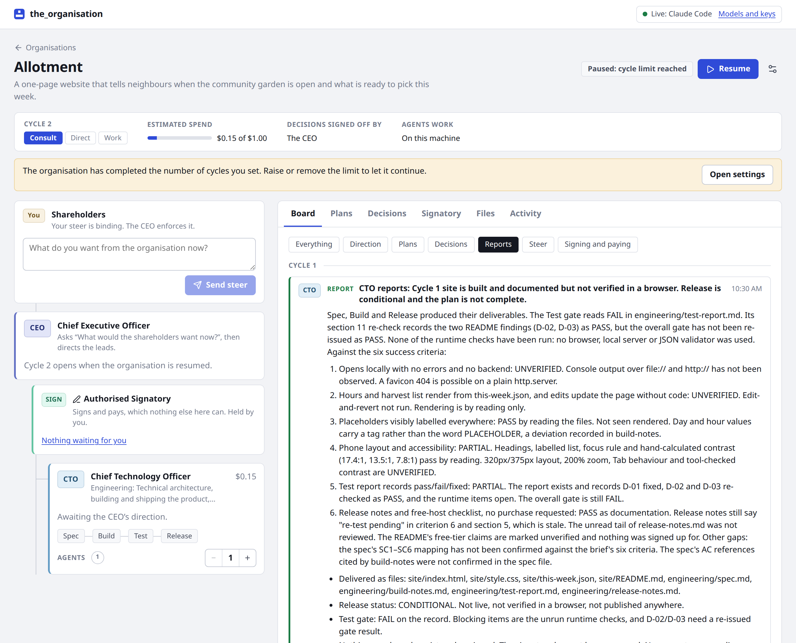
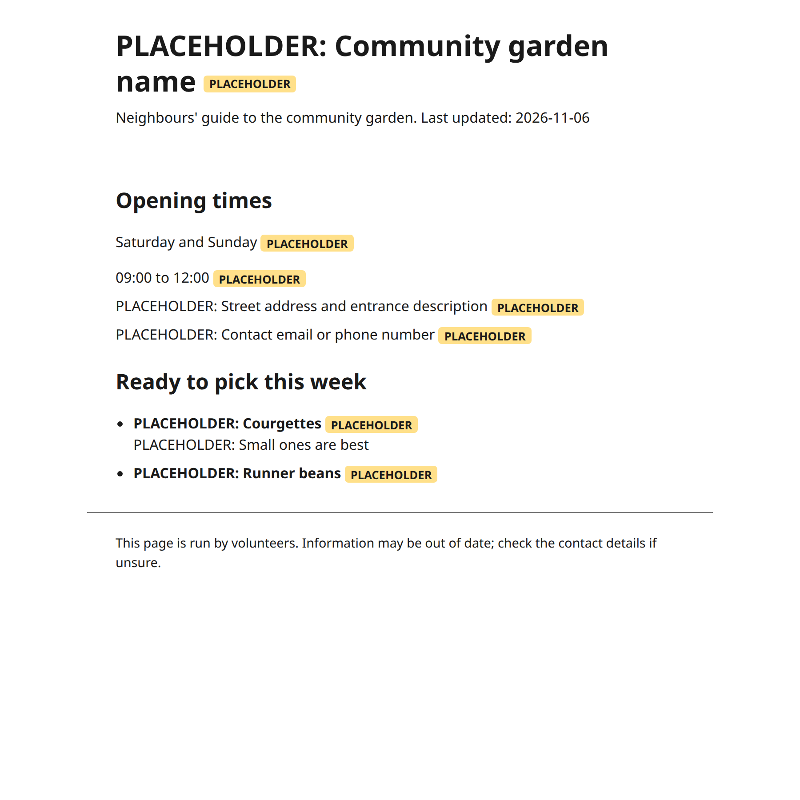

# Earlier live validation: community garden

On 6 November 2026 one small organisation was run from start to finish on real models: one lead (a CTO) with one agent, for one cycle, on Claude Haiku 5.5 through a Claude Code login. The whole prompt was:

> A one-page website that tells neighbours when the community garden is open and what is ready to pick this week.

| | |
| --- | --- |
| Time | 11 minutes |
| Model replies | 59 |
| Tokens | about 900,000, most of them read from cache |
| What the API would have charged | $0.15 |
| Files written | 8: a working page (HTML, CSS, a JSON data file, a README), and a spec, build notes, a test report and release notes |

What it did, unprompted beyond that one sentence:

1. The CTO proposed the work, the CEO set the cycle's direction, and the CTO drafted a plan on its operating profile: Spec → Build → Test → Release.
2. The CTO flagged a point that cut across remits. It went to the board, and the CEO ratified what the board agreed.
3. Spec and Build passed their gates. **Test did not.** The lead found the page's script longer than its own spec allowed, sent it back for rework, and let the phase through once the script was fixed.
4. Release was sent back once as well, and was in the end accepted as conditional, not passed.
5. The report to the board says the site is built and documented but **not verified in a browser**, because agents working on this machine cannot run anything, and that nothing was bought or signed.

The page it built does render. Every fact the organisation was not given, such as the garden's name, its hours and its address, is marked as a placeholder instead of being made up:

That is one small run, on one model, on one day. It is here as evidence that the loop holds together on a real model, not as a claim about what larger organisations will do.
