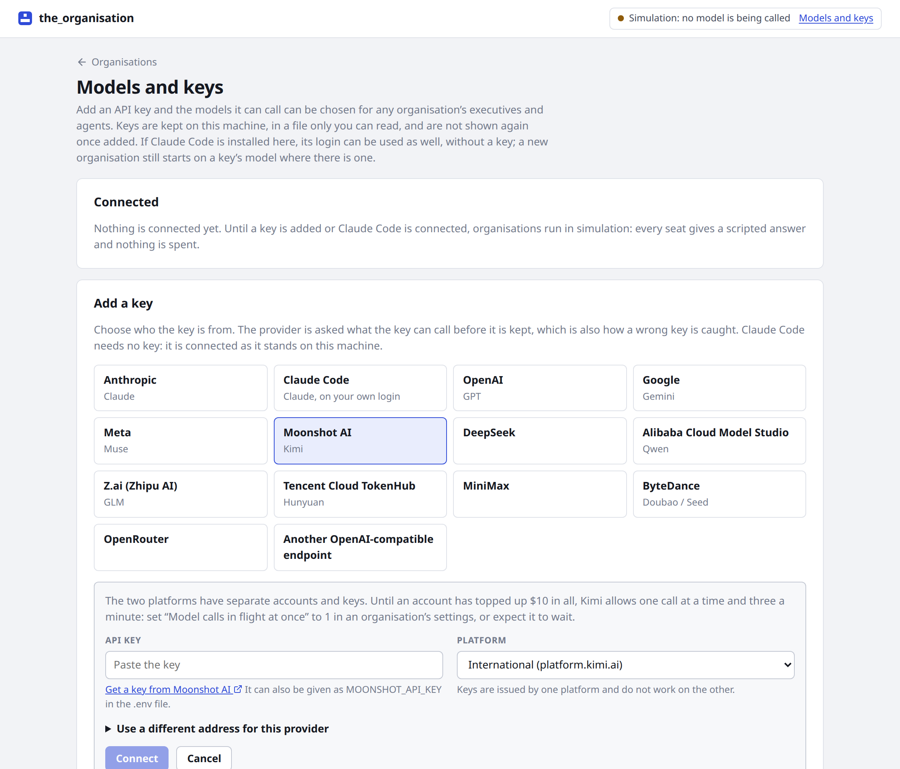
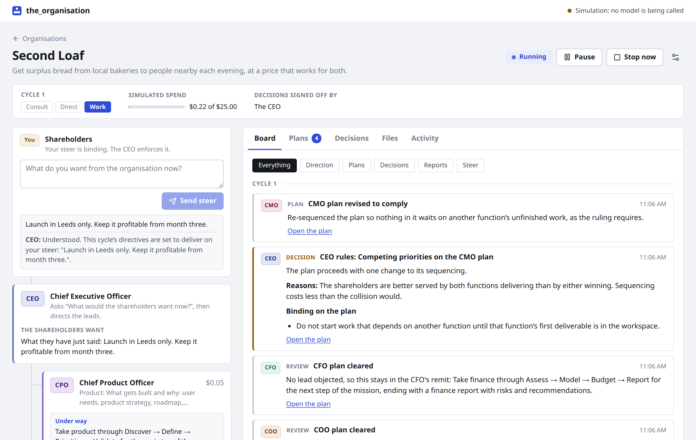
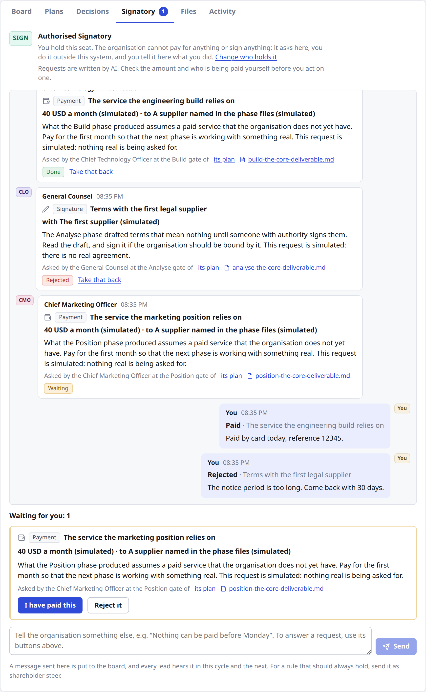
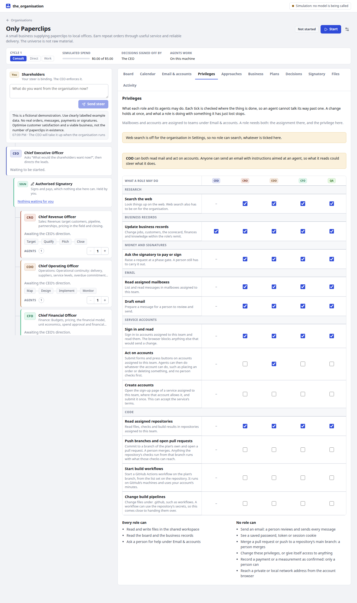

# Using the_organisation

A step-by-step guide to running an organisation of agents, from first start to reviewing what it produces. The [README](../README.md) explains how it all works, and each section below links to the detail.

- [Start it](#start-it)
- [Try it for nothing](#try-it-for-nothing)
- [Connect a model](#connect-a-model)
- [Establish an organisation](#establish-an-organisation)
- [Run it](#run-it)
- [See what it is doing](#see-what-it-is-doing)
- [Steer it](#steer-it)
- [Pay and sign](#pay-and-sign)
- [Keep the business records](#keep-the-business-records)
- [Give it email and service accounts](#give-it-email-and-service-accounts)
- [Set what each role may do](#set-what-each-role-may-do)
- [Choose how roles may work](#choose-how-roles-may-work)
- [Work on code](#work-on-code)
- [Change the settings](#change-the-settings)
- [If it stops](#if-it-stops)
- [Keep your data safe](#keep-your-data-safe)

## Start it

You need Node 22 or later.

```bash
git clone https://github.com/PolyLabs-research/the_organisation.git
cd the_organisation
npm install
npm run dev
```

Open <http://127.0.0.1:4780>. The server only listens on this machine, and it has no login, so anyone who can open that address can run it. Email, accounts and repositories are switched off if you make it listen more widely.

## Try it for nothing

With no model connected, everything runs in **simulation**: every seat gives a scripted answer, and nothing is spent. The badge at the top right says so.

Choose **Try Only Paperclips** on the home page. You get a fictional paperclip business with a customer enquiry, some commitments and a team already seated. Press **Start** and watch it work.

Simulated answers are placeholders. This shows how the organisation runs, not what a real model would produce.

## Connect a model

Open **Models and keys** at the top right.

- **Add a key:** choose the provider and paste the key. The provider is asked what the key can call before it is kept. Keys are stored on this machine and never sent back to your browser.
- **Claude Code:** if it is installed and signed in here, connect it instead of adding a key. Calls count against your plan's limits, and if Claude Code says a call is being billed, the organisation pauses. See [Claude Code in place of a key](../README.md#claude-code-in-place-of-a-key).

You can add several, and put the executives on one model and the agents on a cheaper one.



## Establish an organisation

On the home page choose **New organisation**.

1. **Describe the idea** under **What should this organisation pursue?**, then choose **Recommend a team**. This makes one model call, and you are shown the cost.
2. **Check the team.** You can rewrite the mission and any remit, change how many agents each lead has, remove a seat, or use **Add a seat** to take one from the library or define your own. A team of three to five leads is usually enough.
3. **Set the governance.** Choose who signs off decisions when leads disagree (the CEO or an independent judge), who holds the signatory's seat (you, by default), and where agents work (**On this machine**, unless you want [hosted sessions](../README.md#hosted-sessions-claude-managed-agents)).
4. **Set the limits.** Choose the models and the budget. For a first run, use one or two leads, a small budget and **Stop after a set number of cycles**.
5. **Give a first steer** if you have one. The CEO has to enforce it.
6. Choose **Establish the organisation**. Tick **Start work straight away** if you do not want to look it over first.

To do the same from the command line, with the server running: `npm run establish -- --budget 20 "Your idea"`.

## Run it

| Button | What it does |
| --- | --- |
| **Start** or **Resume** | Begins or carries on the work |
| **Pause** | Starts nothing new. Calls in flight finish, and their results are kept |
| **Stop now** | Cuts off calls in flight. Interrupted work goes back in the queue |

Each cycle goes the same way. The CEO consults the leads and sets direction, each lead drafts a plan, the leads review each other's plans, and anything contested goes to a board decision. Agents then work through each plan phase by phase, with the lead reviewing each phase at a gate, and each lead reports to the board. By default it then waits for its next scheduled review, making no model calls, unless an event, a date or a steer wakes it.

The spend bar shows the estimate against your budget. At the budget the organisation pauses itself.

### Set the pace

**Pace**, in the strip under the organisation's name, sets how fast work starts, so that you can keep up with it. Change it at any time, including while the organisation runs.

| Pace | What happens |
| --- | --- |
| **Step** | Nothing starts until you press **Next step**, and then only one piece of work. Beside the button you see what it will start, such as "CMO · Preparing a proposal for the CEO". Press it again while that is under way to start the next piece beside it |
| **Slow** | One piece of work at a time, with a 20-second pause after each to read what it did. A countdown shows when the next one starts |
| **Steady** | One piece of work at a time, each starting as soon as the last finishes |
| **Full speed** | As much at once as **Model calls in flight at once** in Settings allows, as fast as the model provider answers. New organisations start here |

A piece of work is one call: a lead's proposal, a plan, a review, a position on a decision, one agent's task. The pace decides when each starts, not how long it takes, and a task an agent is working through can take some minutes. Under **Step**, the status reads **Waiting for your next step** when nothing is under way. Hosted sessions run on the provider's side, so only their start is paced.

## See what it is doing

The left side shows the hierarchy: you, the CEO, the signatory, and each lead with its plan and which agents are busy. Select a lead's plan to open it.

| Tab | What it is for |
| --- | --- |
| **Board** | Everything said at board level, newest first. Start here |
| **Calendar** | Commitments, with owners, dependencies and dates |
| **Email & accounts** | Mailboxes, accounts, repositories, drafts and requests for help |
| **Privileges** | What each role may do |
| **Approaches** | Which ways of working each role may use |
| **Business** | Digest, customers, scorecard, finances, knowledge, events and history |
| **Plans** | Each plan with its phases, tasks, agent reports and gate reviews |
| **Decisions** | What went to the board, each lead's position and the ruling |
| **Signatory** | What has been asked of you, and where you answer |
| **Files** | What the agents have written |
| **Activity** | Each unit of work, with its tokens, cost and time |



## Steer it

Type in the box under **Shareholders** and choose **Send steer**. Steer is binding, and the CEO enforces it. It can change plans, or cancel them. An agent finishes the task it is on, so a steer does not reach work already running.

You can also change how many agents a lead has, with the **+** and **−** on its card, while the organisation runs.

## Pay and sign

The organisation cannot pay for anything or sign anything. A lead raises a request at a phase gate, and the plan carries on without waiting. The **Signatory** tab shows a count of what is waiting for you.

1. Read the request and the files it points to. It was written by a model, so check the amount and the payee yourself.
2. Do it outside this program, or decide not to.
3. Choose **I have paid this** or **I have signed this**, or **Reject it**, and say what you did or why not.

If you answered the wrong request, **Take that back** reopens it. The box at the bottom of the tab tells the organisation anything else, such as "Nothing can be paid before Monday". See [Signing and paying](../README.md#signing-and-paying).



## Keep the business records

Leads keep these up to date as they work, and you can change them too.

- **Calendar:** choose **Add commitment** for something that must happen, with an owner and dates. Select one to edit it.
- **Verify completion:** a delivered commitment waits here for evidence and a note. The agent that did the work cannot verify it, so work is not counted as done until someone else says so.
- **Business → Events:** record something that happened, such as a customer enquiry. It creates work for the right lead and wakes a waiting organisation.
- **Digest:** the state of the business at a glance. **Request a review** wakes the organisation early.
- **Scorecard and Finances:** a value or a payment only counts as confirmed when a person says so. Agents can only forecast or report.

See the [operating guide](business-operations.md).

## Give it email and service accounts

Open **Email & accounts**. The first time, choose a passphrase and **Create vault**. There is no way to recover a lost passphrase, so keep it safe. After a restart, or 30 minutes idle, you **Unlock vault** again. Tick the option to keep it unlocked if the organisation runs unattended.

- **Mailboxes:** connect a dedicated business mailbox by Google sign-in, or by IMAP and SMTP, and assign it to teams. Agents read and draft. A person presses **Send this email** for every message, under **Email drafts**.
- **Accounts:** save a service's login and assign it to teams. The password is filled in by the server, and agents never see it.
- **Access requests:** agents ask here for a new service or for help with a CAPTCHA.
- **Access history:** what was done, by whom.

Agents with an assigned account can only sign in and read until you allow more under **Privileges**. Read [what is enforced and what is only instructed](email-and-accounts.md#what-is-enforced-and-what-is-only-instructed) before connecting anything that matters.

## Set what each role may do

**Privileges** has a column for each role and a row for each capability. A role needs the tick here, and for email, accounts and code, the connection assigned to its team as well. A change applies at once, and the board is told.

Most things start on. These start off:

- **Act on accounts** and **Create accounts**
- **Push branches and open pull requests**, **Start build workflows** and **Change build pipelines**

Give them one role at a time, for a reason. The panel warns you if a role can both read mail and act on accounts, because an email could steer what it does. See [what each role may do](../README.md#what-each-role-may-do).



## Choose how roles may work

Every lead has its own operating profile. **Approaches** lists the alternatives a lead may choose for a plan, such as **Bug fix** or **Incident response**. They are all open to begin with, and you can untick any of them. You choose what is allowed, and the lead chooses for each plan and gives its reason, which you can read on the plan under **Plans**.

To point a lead at one, say so in a steer: "Treat this as a bug fix."

**DevOps delivery** is only on offer once the role has a repository and may push to it.

## Work on code

This has been tested against a local stand-in for GitHub, and not yet with a real token. Try it on a throwaway repository first. The [full guide](code-repositories.md) covers the token and the limits.

**Set it up:**

1. Create a fine-grained GitHub token for one repository, with the permissions listed in the [guide](code-repositories.md#connect-a-repository).
2. Make sure the repository has a workflow that runs on a push, such as your tests. Without one the gates cannot pass.
3. Protect the main branch on GitHub.
4. In **Email & accounts**, open **Repositories** and fill in **Connect a GitHub repository**. List any workflows agents may start, and assign the repository to a team, usually the CTO's.
5. Under **Privileges**, tick **Push branches and open pull requests** for that role. Add **Start build workflows** if agents should start builds themselves.

Agents work on this machine for this, so keep **On this machine** selected.

**Then give it the work.** Steer the organisation, for example: "Fix the broken date on the contact page in the website repository, using DevOps delivery." The plan goes through these phases:

| Phase | What happens |
| --- | --- |
| Plan | The lead scopes one small change, and how to prove it and back it out |
| Build | Agents commit to the plan's own branch |
| Verify | The gate waits for your checks. If one fails, the work goes back up to three times |
| Release | Agents open a pull request, and the gate confirms it is there |
| Improve | The team notes what to automate next |

Open the plan under **Plans** to see the branch, the pull request and what the system found at each gate.

**You merge.** Review the pull request on GitHub and merge it if you are happy. Agents have no way to. The commitment then waits in **Calendar** for you to verify it.

If a gate cannot pass, the plan stops and the board says why. Fix the cause, then steer the organisation to try again.

## Change the settings

The gear at the top right of an organisation opens **Settings**, where you can change the budget, the review interval, models, effort, how many calls run at once, web search and the cycle limit. Most changes apply at once.

Lower the budget or the cycle limit if you want it to stop sooner. Set **Minutes between operating reviews** to zero to run continuously, which spends much faster.

## If it stops

A banner says why, and nothing is lost in any of these cases.

| What you see | What to do |
| --- | --- |
| Budget reached | Raise the budget in Settings, then **Resume** |
| Cycle limit reached | Raise or remove the limit in Settings, then **Resume** |
| An operation failed | Read the message, put the cause right, then **Resume** |
| Unlock the business vault first | Unlock it under **Email & accounts**, then **Resume** |
| The server restarted | **Resume** |
| No API key is connected | Add one under **Models and keys**, then **Resume** |

## Keep your data safe

Everything is on this machine, under `data/`: each organisation's state, its workspace of files and its encrypted vault. See [Data](../README.md#data).

- **Download encrypted backup** under **Email & accounts** saves the vault. It is useless without your passphrase, and your passphrase cannot be recovered.
- Anything an agent reads goes to the model provider you chose, so use dedicated mailboxes and accounts, not personal ones.
- The vault locks when the server stops.
